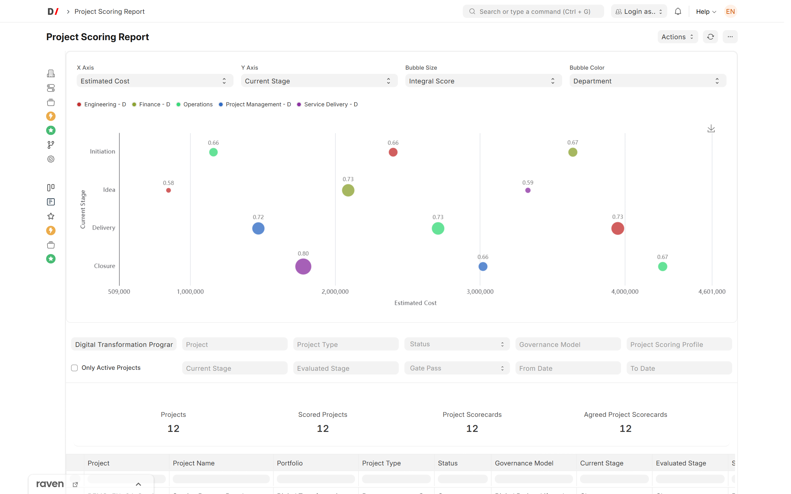
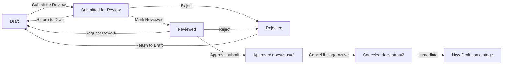
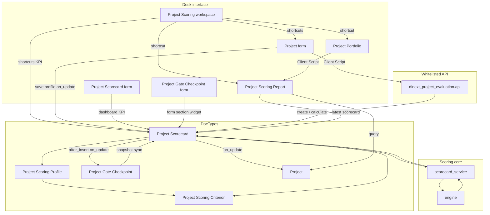

[Русский](README.ru.md)

<!-- dinext-presentation:start -->
<p align="center">
  <a href="https://dinext.ru"></a>
</p>
<h1 align="center">Dinext Project Evaluation</h1>

<hr>

<p align="center">Project scoring with weighted criteria, scorecards, approval gates and portfolio comparison charts.</p>

<p align="center">
  
</p>
<p align="center"><sub>Project scoring and portfolio comparison with demonstration data.</sub></p>

<p align="center">
  <a href="https://dinext.ru">Website</a> · <a href="https://docs.dinext.ru">Documentation</a>
</p>
<!-- dinext-presentation:end -->

# Dinext Project Evaluation

## 📖 Overview

**Dinext Project Evaluation** is a Frappe/ERPNext application for formal project scoring, scorecard documents, and portfolio analytics on top of standard ERPNext Projects. PMOs and project managers can define evaluation criteria and profiles, complete scorecards for project stages, calculate a weighted overall score with gate rules, and compare projects in a Script Report with a bubble chart.

The application integrates with existing Dinext project management (Project Portfolio, Project Stage, stage-gate) and does not replace the stage-gate module. Fixture-backed standard criteria and a starter scoring profile are imported automatically during installation and `migrate`.

## ✨ Features

- **Scoring criteria catalog** — numeric, currency, percentage, boolean, and qualitative (scale) values with an influence direction and optional Likert scales.
- **Scoring profiles** — weights, mandatory criteria, gate thresholds for mandatory criteria (normalized score and/or raw number), and applicability by stage; the UI shows only relevant threshold fields.
- **Project Scorecard** — a submittable DocType with the **Dinext Project Scorecard Approval** workflow (dedicated approval roles, separate from stage-gate), a profile snapshot, overall score and gate calculation, and mandatory-criteria validation when leaving Draft. **Dashboard KPIs** on the scorecard form: compact **Integral Score**, **Gate Pass**, and **Last Recalculated** blocks in `frm.dashboard` after calculation (the “Evaluation Summary” section); manual recalculation through the **Recalculate Score** menu item. Only a submitted scorecard (`docstatus = 1`) is considered **agreed**; the `status` field remains a business indicator for the UI. See [Approval workflow](#project-scorecard-approval-workflow) and [Dashboard KPIs on the Project Scorecard form](#dashboard-kpis-on-the-project-scorecard-form).
- **Automatic Draft scorecard creation** — when a scoring profile is assigned to a project with an active stage, or when **Project Stage Instance** becomes **Active** (if a profile is already set on the project); idempotent, without duplicates for a stage instance.
- **Project form UI** — form script (`project_scoring_evaluation.js`): scoring profile selection (only when a Governance Model is set), **Open Scorecards** / **Open Scoring Report** buttons in the Evaluation menu, navigation to the portfolio report, and profile reset when the governance model changes or is cleared.
- **Project Portfolio UI** — navigation to the scoring report and bubble chart for the selected portfolio.
- **Project Scoring Report** — filters by portfolio, project, project type, status, governance model, **Project Scoring Profile** (`custom_project_scoring_profile`), active projects only (`is_active = Yes`), current and evaluated stage, gate pass, and evaluation date range; includes submitted scorecards (`docstatus = 1`); a data table, server-side bubble payload, and client-side bubble chart (ECharts); **clicking a bubble** opens the associated **Project Scorecard**, or the **Project** form if no scorecard is available. The X/Y axes, bubble size, and color use **dynamic metrics** from runtime metadata (**Project**, **Project Scorecard**, and profile criteria); metric lists account for the current dataset and hidden DocType fields. See [Project Scoring Report: dynamic metrics](#project-scoring-report-dynamic-metrics-and-bubble-chart).
- **Default fixture catalog** — 10 criteria groups, 21 criteria, and the active **Базовый профиль оценки проектов** (Base Project Scoring Profile, `Default Project Scoring Profile`) with Russian display names, domain-specific 0–5 scales, realistic numeric ranges, and stage-aware rows for stage-gate stages (Идея / Idea, Инициирование / Initiation, Реализация / Execution, Завершение / Closure). System keys (`name`, `group_code`, `criterion_code`) remain in English for compatibility with `hooks.py` and reports.
- **Pure scoring engine** — a calculation module independent of the Frappe ORM, with unit tests for normalization, weighting, and gate logic.
- **Stage Gate integration** — the **Require Agreed Stage Scorecard** flag on `Stage Gate Template`; when enabled, a checkpoint cannot enter **In Review** without a submitted scorecard (`docstatus = 1`) for the same `Project Stage Instance`. On the `Project Gate Checkpoint` form, the **Stage Scorecard** section (after `decision_comment`) contains a clickable KPI widget styled like the scorecard and linking to the associated document; failed gate thresholds produce a **soft** warning and do not block review. See [Stage Gate and scorecard integration](#stage-gate-and-scorecard-integration).
- **“Скоринг проектов” (Project Scoring) workspace** — a public Desk workspace with KPI number cards for scorecard statuses and scoring profile coverage, shortcuts to the portfolio report and operational DocTypes, and a catalog setup card; accessible to scorecard roles, `Dinext_Project_Manager`, and `System Manager`. See [“Скоринг проектов” (Project Scoring) workspace](#скоринг-проектов-project-scoring-workspace).

## 🚀 Installation

Install with [bench](https://github.com/frappe/bench):

```bash
cd $PATH_TO_YOUR_BENCH
bench get-app $URL_OF_THIS_REPO --branch develop
bench --site <site> install-app dinext_project_evaluation
bench --site <site> migrate
```

The source of truth for the starter scoring catalog is the versioned fixtures in `dinext_project_evaluation/fixtures/`. After `install-app` and `migrate`, the workflow, roles, report, custom fields, and default catalog are imported into the site.

After changing metadata, workflows, or fixture-backed master data, export the fixtures to the repository (`dinext_project_evaluation/fixtures/`):

```bash
bench --site <site> export-fixtures
```

`migrate` imports fixtures, including the **Dinext Project Scorecard Approval** workflow, scorecard approval roles, and `Default Project Scoring Profile`. The application does not use one-off data migration patches: DocType JSON, fixtures, and runtime hooks provide the current schema and behavior.

### Starter scoring catalog (demo fixtures)

After `install-app` / `migrate`, the versioned demo catalog from `dinext_project_evaluation/fixtures/` is imported into the site. Records on the bench site and `bench export-fixtures` are the source of truth; do not edit repository JSON manually.

**Localization boundary:**

| Layer | Language | Examples |
|------|------|---------|
| System keys and references | English | `Strategy`, `STR_ALIGN`, `Default Project Scoring Profile` |
| Demo data display fields | Russian | `group_name`, `criterion_name`, `scale_label`, `key_phrases`, `profile_name`, `description` |
| DocType / workflow UI | Russian through `translations/ru.csv` | Field labels, workflow buttons |

**Criteria groups** (`project_scoring_criterion_group.json`) — 10 records with Russian `group_name` values and stable `name` / `group_code`: Стратегическое соответствие (Strategic alignment), Выгоды (Benefits), Рынок и клиенты (Market and customers), Финансовая эффективность (Financial performance), Риски (Risks), Ресурсная обеспеченность (Resource availability), Нормативные ограничения (Regulatory constraints), Приоритет и срочность (Priority and urgency), Инновационный потенциал (Innovation potential), Среда и зависимости (Environment and dependencies).

**Criteria** (`project_scoring_criterion.json`) — 21 criteria with Russian names, descriptions, and domain-specific Likert scales from 0 to 5 (instead of generic “very low / low / …” labels). Numeric criteria have realistic ranges consistent with `influence_direction`:

| Code | Type | Range / scale |
|-----|-----|------------------|
| `STR_ALIGN`, `BEN_FIN`, `MKT_SHARE`, … | Scale 0–5 | Domain-specific wording appropriate to the criterion |
| `COST`, `RD_COST`, `MFG_COST` | Currency | 0 … RUB 200–500 million (`lower_is_better`) |
| `NPV`, `ECV` | Currency | −200 … +1000 million / −50 … +500 million RUB |
| `IRR`, `TECH_SUCCESS` | Percent | 0 … 60% / 0 … 100% |
| `PP` | Number (months) | 0 … 84 (`lower_is_better`) |
| `PI` | Number | 0 … 3 |
| `SALES_POT` | Boolean | Confirmed sales potential |

**Default profile** (`project_scoring_profile.json`) — one `Default Project Scoring Profile` record:

- **profile_name:** “Базовый профиль оценки проектов” (Base Project Scoring Profile)
- **status:** Active
- **21 global rows** — all catalog criteria with weights of 1–3 and the **Desired** level
- **15 stage-specific rows** — stronger requirements and gate thresholds at stage-gate stages (stage names match `Project Stage` in the `dinext_project_stage_gate` application):

| Stage | Examples of stronger requirements |
|--------|------------------|
| **Идея (Idea)** | `BEN_FIN`, `MKT_SHARE` — Mandatory, min normalized 0.4 |
| **Инициирование (Initiation)** | `STR_ALIGN` — Mandatory, min normalized 0.6; risks and resources — Mandatory |
| **Реализация (Execution)** | `TECH_SUCCESS` — Mandatory, raw 65…100%; `SALES_POT` — Mandatory (boolean gate) |
| **Завершение (Closure)** | `REG` — min normalized 0.8; `NPV` — min raw 50 million; `IRR` — 18…60%; `PP` — max 36 months |

Stage-specific rows **override** global rows for the same “criterion + stage” pair during scorecard calculation (`resolve_stage_overridden_profile_rows`).

**Updating the demo catalog on a site:**

```bash
# 1. Change groups / criteria / profile in Desk or through bench execute
# 2. Export the fixtures back to the repository
bench --site <site> export-fixtures --app dinext_project_evaluation
```

Fixture integrity regression test: `tests/test_scoring_demo_catalog.py`.

## Project Scorecard approval workflow

The scorecard lifecycle is managed by **Frappe Workflow**, using the **`status`** state field and the standard **`docstatus`** of a submittable document. The status is read-only on the form; transitions use workflow buttons on the **Project Scorecard** form.

**Workflow:** `Dinext Project Scorecard Approval`  
**Repository source:** `dinext_project_evaluation/fixtures/workflow.json`, `workflow_state.json`, `workflow_action_master.json`, `role.json`

### Submittable lifecycle and an “agreed” scorecard

| Concept | Source of truth | Note |
|---------|-----------------|------------|
| Business status (Draft, Reviewed, Approved…) | `status` field | UI, editing roles, integral/gate calculation |
| Agreed / final scorecard | **`docstatus = 1`** | Portfolio report, `custom_last_*` on Project, downstream gates |
| Canceled scorecard | `status = Canceled` and **`docstatus = 2`** | Does not block a new scorecard for the stage |

The **Reviewed → Approved** workflow transition calls `doc.submit()` (the Approved workflow state has `doc_status = 1`). A submitted scorecard is canceled through the **Cancel** workflow action (Approved → Canceled), or through programmatic cancellation for drafts in intermediate statuses.

### Roles (separate from stage-gate)

| Role | Purpose |
|------|------------|
| **Project Scorecard Author** | Creates scorecards, enters criteria in Draft, and submits them for review |
| **Project Scorecard Reviewer** | Checks completeness, moves to Reviewed, or returns for revision |
| **Project Scorecard Approver** | Approves a scorecard (Reviewed → Approved) and **cancels** scorecards (Cancel) |
| **Project Scorecard Admin** | Full DocType access; submit permission without cancel permission |

Recommended mapping to existing Dinext roles (see `scoring/workflow_constants.py`):

| Dinext role | Scorecard role |
|-------------|----------------|
| `Dinext_Project_Manager` | Project Scorecard Author |
| `Project Governance Admin` | Project Scorecard Admin |

Users must be assigned the appropriate scorecard roles in **User** (in addition to Project / portfolio permissions). Stage-gate roles (`Stage Gate Owner`, `Reviewer`, `Approver`) are **not** used in the scorecard workflow.

### Statuses, docstatus, and calculation

| Status (`status`) | `docstatus` | Meaning | Integral / gate calculation | Included in portfolio report |
|-------------------|-------------|--------|------------------------|-------------------|
| Draft | 0 | Draft, value entry | No | No |
| Submitted for Review | 0 | Under review | Yes (on save) | No |
| Reviewed | 0 | Review complete | Yes (on save, recalculation) | No |
| Approved | **1** | Approved (submitted) | Yes (on save) | **Yes** |
| Rejected | 0 | Returned for revision | No | No |
| Canceled | **2** | Process terminated | No | No |

Criteria values and comments can be edited manually only in **Draft**; all other statuses allow workflow transitions and system recalculation, but no content editing. Approved and canceled scorecards cannot return to earlier statuses.

### Uniqueness and replacement after Cancel

- Each **`stage_instance_at_evaluation`** may have **at most one** scorecard with a status other than **Canceled** (including Draft and Rejected — repeated creation reuses the existing scorecard instead of duplicating it).
- After **Cancel**, a new **Draft** is created **immediately** for the stage, with the same project, profile, and `stage_instance_at_evaluation` (if the stage is still **Active** and has no scorecard).
- **Cancel** is available only to a user with the **Project Scorecard Approver** role and only while the associated **Project Stage Instance** is **Active**. A workflow condition on the Approved → Canceled transition hides the Cancel button in the UI; `before_cancel()` repeats this validation on the server.

### Workflow transitions

| From | Action | To | Who | Note |
|----|----------|---|-----|------------|
| Draft | Submit for Review | Submitted for Review | Author | Integral / gate calculation |
| Submitted for Review | Return to Draft | Draft | Reviewer | |
| Submitted for Review | Mark Reviewed | Reviewed | Reviewer | |
| Submitted for Review | Reject | Rejected | Reviewer | |
| Reviewed | Request Rework | Draft | Reviewer / Approver | |
| Reviewed | Approve | Approved | Approver | `doc.submit()` |
| Reviewed | Reject | Rejected | Approver | |
| Rejected | Return to Draft | Draft | Author | |
| Approved | Cancel | Canceled | Approver | Only if the stage instance is **Active**; `doc.cancel()` |

Cancellation from **Draft / Submitted / Reviewed / Rejected** is not a workflow transition (a Frappe limitation: workflows cannot perform `docstatus 0 → 2`). `scoring/scorecard_cancel.py` handles these cases (programmatic cancellation + replacement draft).



### Developing workflow metadata

Under Dinext policy, workflows, roles, and states are created in the system (MCP / Desk), then exported:

```bash
bench --site <site> migrate
bench --site <site> export-fixtures
```

Do not edit `fixtures/workflow*.json` and `role.json` manually — export them after changing the site. Exception: the condition on the **Cancel** transition (Approved → Canceled) checks for an active stage instance and must match the logic in `scoring/scorecard_cancel.py`.

## Stage Gate and scorecard integration

This application provides Stage Gate DocType extensions through `fixtures/custom_field.json`, `doc_events`, and `doctype_js`. The **dinext_project_stage_gate** application must be installed (`required_apps`).

### Configuring a checkpoint template

The **Require Agreed Stage Scorecard** flag (`require_agreed_stage_scorecard`) is available on **Stage Gate Template**. When a **Project Gate Checkpoint** is created, this application's `doc_events` (`before_insert` / `after_insert`) copy the value into the checkpoint's read-only field of the same name. It then acts as a snapshot: later template changes do not affect existing checkpoints. The Stage Gate app is unchanged.

If the snapshot flag is enabled on a checkpoint, the document cannot enter **In Review** until a submitted **Project Scorecard** (`docstatus = 1`) exists for the same **Project Stage Instance**.

An **agreed** scorecard is determined solely by `docstatus`, not the business `status`. The scorecard's business status (`status`) appears in the checkpoint dashboard widget for operator context.

### Behavior on the Project Gate Checkpoint form

Whenever a checkpoint is saved, the server synchronizes hidden read-only scorecard summary fields (a denormalized snapshot):

| Field | Purpose |
|------|------------|
| `linked_stage_scorecard` | Link to the current (latest non-canceled) scorecard for the stage instance |
| `scorecard_display_title` | Human-readable title (`scorecard_title`) |
| `scorecard_status` | Scorecard business status |
| `scorecard_integral_score` | Overall score |
| `scorecard_gate_pass` | Gate result from the scorecard |
| `scorecard_gate_warning` | Warning text from `gate_messages` when the gate is not passed |

Summary fields are **hidden in the form layout** and cannot be edited by the user — they support server synchronization, API fallback, and tests. The operator-facing display uses the `stage_scorecard_widget_mount` HTML mount point in the **Stage Scorecard** section.

Gate thresholds are not duplicated on the stage-gate template — only the scorecard's calculated fields (`gate_pass`, `gate_messages`) from the scoring profile are used.

### Stage Scorecard widget on the Project Gate Checkpoint form

The form script [`public/js/project_gate_checkpoint_scorecard.js`](dinext_project_evaluation/public/js/project_gate_checkpoint_scorecard.js) renders a clickable KPI widget in the **original form section**, **Stage Scorecard** (after `decision_comment`), through the `stage_scorecard_widget_mount` HTML mount point. It matches the visual style of **Evaluation Summary** on the **Project Scorecard** form, but resides in the form layout rather than `frm.dashboard`.

| KPI | Content |
|-----|------------|
| **Integral Score** | `scorecard_integral_score` (formatted with `flt(..., 2)`; “Not calculated” if unavailable) |
| **Gate Pass** | Passed / Failed, color-coded by `scorecard_gate_pass` |
| **Scorecard Status** | Business status of the associated scorecard (`scorecard_status`) |

The widget header contains the associated document's title (`scorecard_display_title` or `linked_stage_scorecard`), the scorecard number, and the **Open scorecard** label. When `gate_pass = 0`, reasons from `scorecard_gate_warning` appear below the cards (a soft warning: a checkpoint can enter review if an agreed scorecard exists).

**When the section and widget appear:** the section is visible when `require_agreed_stage_scorecard = 1`; the widget inside it appears when `linked_stage_scorecard` exists (after server synchronization or API fallback when opening the form).

**Navigation:** clicking the widget (or pressing Enter/Space while focused) opens the associated **Project Scorecard** through `frappe.set_route`.

**Technical details:**

- Styling: shared [`public/css/project_scorecard_dashboard.css`](dinext_project_evaluation/public/css/project_scorecard_dashboard.css) + `.dpe-checkpoint-scorecard-*` classes; lazy loading through `frappe.require`; Desk CSS variables for light/dark themes.
- Idempotent refresh: clears the `.dpe-checkpoint-scorecard-widget-mount` mount point and uses a render token to prevent duplication during asynchronous CSS loading.
- Translations: the `Project Gate Checkpoint.StageScorecard` context in [`translations/ru.csv`](dinext_project_evaluation/translations/ru.csv).

### Synchronization when a scorecard changes

The checkpoint summary is updated when:

- the checkpoint is saved (validate);
- a scorecard is submitted / canceled / has its calculated fields changed;
- `recalculate_in_place()` runs on a scorecard (without a workflow change).

Checkpoints and scorecards are matched by `stage_instance` = `stage_instance_at_evaluation`.

### API

`dinext_project_evaluation.api.get_checkpoint_scorecard_summary(checkpoint)` provides a normalized summary for form refresh; the checkpoint form calls this API as a fallback if the snapshot fields are still empty.

The scorecard summary on a checkpoint is synchronized when the checkpoint is saved, on scorecard `after_insert`, and when the scorecard's calculated fields change.

## “Скоринг проектов” (Project Scoring) workspace

The public Frappe Workspace in the **Dinext Project Evaluation** module is a single entry point for PMOs and project managers. Its metadata is versioned in the repository and imported into the site during `install-app` / `migrate` (standard module JSON import, not through `fixtures` in `hooks.py`).

**Repository path:** `dinext_project_evaluation/dinext_project_evaluation/workspace/скоринг_проектов/скоринг_проектов.json`  
**Number Card fixtures:** `dinext_project_evaluation/dinext_project_evaluation/number_card/`

In Desk: sidebar → **Скоринг проектов** (Project Scoring; `activity` icon, Dinext Project Evaluation module).

### Access

The workspace is visible to users with any of these roles:

| Role | Purpose |
|------|------------|
| **Project Scorecard Author** | Scorecard authors |
| **Project Scorecard Reviewer** | Reviewers |
| **Project Scorecard Approver** | Approvers |
| **Project Scorecard Admin** | Scorecard administrators |
| **Dinext_Project_Manager** | Dinext project managers |
| **System Manager** | Full Desk access |

### Sections and navigation

| Workspace section | Content |
|---------------------|------------|
| **Сводка оценки проектов** (Project evaluation summary) | Six KPI number cards (see table below) |
| **Аналитика портфеля** (Portfolio analytics) | **Отчёт: оценка проектов** (Project evaluation report) shortcut → **Project Scoring Report** |
| **Работа с карточками оценки** (Working with scorecards) | Shortcuts: **Карточки оценки проектов** (Project scorecards), **Проекты** (Projects), **Портфели проектов** (Project portfolios) |
| **Профили и критерии** (Profiles and criteria) | Card links: **Project Scoring Profile**, **Project Scoring Criterion**, **Project Scoring Criterion Group**, **Project Scorecard** |

### KPI number cards

The workspace displays user-facing labels; each card in the repository is a separate standard **Number Card** (`is_standard = 1`, `is_public = 1`, `function = Count`).

| Workspace label | Number Card name | DocType | Filter |
|----------------------|-----------------|---------|--------|
| **Оценки в работе** (Evaluations in progress) | Карточки в работе (Scorecards in progress) | Project Scorecard | `status` in Draft, Rejected |
| **Оценки на согласовании** (Evaluations awaiting approval) | Карточки на согласовании (Scorecards awaiting approval) | Project Scorecard | `status` in Submitted for Review, Reviewed |
| **Согласованные оценки** (Agreed evaluations) | Согласованные карточки (Agreed scorecards) | Project Scorecard | `status` = Approved |
| **Оценки с непрохождением ворот** (Evaluations failing gates) | Карточки с непрохождением gate (Scorecards failing gates) | Project Scorecard | `status` = Approved and `gate_pass` = 0 |
| **Проекты с профилем оценки** (Projects with a scoring profile) | Проекты с профилем оценки (Projects with a scoring profile) | Project | `custom_project_scoring_profile` is set |
| **Проекты без профиля оценки** (Projects without a scoring profile) | Проекты без профиля оценки (Projects without a scoring profile) | Project | `custom_project_scoring_profile` is not set |

Scorecard cards use the business **`status`** field (as in the workflow), rather than `docstatus` — for agreed evaluations, the **Approved** filter matches the submitted lifecycle (`docstatus = 1` after Approve).

### Developing workspace metadata

Under Dinext policy, workspaces and number cards are created or edited in Desk (or through MCP), then exported to module JSON:

```bash
bench --site <site> export-doc "Workspace" "Скоринг проектов"
bench --site <site> export-doc "Number Card" "Карточки в работе"
# … for the other number cards
```

Alternatively, copy the updated JSON from `sites/<site>/…` into the module's `workspace/` and `number_card/` directories. Structural regression tests: `tests/test_project_scoring_workspace.py`.

## 🛠️ Usage

### In the Desk interface

1. Open the **Скоринг проектов** (Project Scoring) workspace for KPI summaries and shortcuts, or open **Project Scoring Criterion** and **Project Scoring Profile** directly to review or extend the catalog (or use the default fixture catalog).
2. In **Project Scoring Profile**, set the weight, requirement level, and optional gate thresholds for each criterion row:
   - **Desired** — threshold fields are hidden; the gate is not checked.
   - **Mandatory + scale/yes-no** — only **Minimum Normalized Score** (0…1) is available.
   - **Mandatory + Number/Currency/Percent** — normalized score and **Minimum/Maximum Raw Value** are available.
   - Irrelevant thresholds are cleared automatically when a row changes and when the profile is saved; opening the form only shows/hides fields.
3. Set **Governance Model** (from the stage-gate application) on the **Project** form — the **Project Scoring Profile** field (`custom_project_scoring_profile`) is available only when a governance model is set. The link query filter accounts for portfolio, company, and project type.
4. Fill in **Project Scoring Profile** and save the project. The **first** time a profile is assigned to a project with an active stage, a **Draft** scorecard is created automatically for the current **Project Stage Instance** (see [Automatic Project Scorecard creation](#automatic-project-scorecard-creation)). Changing the profile or governance model cancels active scorecards (see [Resetting a profile and scorecards on Project](#resetting-a-profile-and-scorecards-on-project)).
5. Complete the scorecard rows in **Draft** (or open the automatically created draft through **Open Scorecards**). On transition to any other status (except **Canceled**), both the server and form check that all **Mandatory** criteria are filled in; empty cells are highlighted in the **Value** column.
6. Move the scorecard through the workflow: **Submit for Review** (overall score and gate calculation) → **Mark Reviewed** (recalculation if needed) → **Approve** (submit, `docstatus = 1`). After **Submit for Review**, the scorecard form dashboard displays the **Evaluation Summary** section with **Integral Score** and **Gate Pass** KPIs (see [Dashboard KPIs](#dashboard-kpis-on-the-project-scorecard-form)). Approved, submitted scorecards update the denormalized Project fields.
7. If necessary, use **Cancel** (only an **Approver**, and only while the stage instance is **Active**) — a new Draft is created for the same stage.
8. Open **Project Scoring Report** from **Project Portfolio** to compare projects and view the bubble chart.
9. In the report, use filters for portfolio, project, project type, status, governance model, **Project Scoring Profile**, “only active projects,” current and evaluated stage, gate pass, and evaluation date range; **X Axis**, **Y Axis**, **Bubble Size**, and **Bubble Color** are separate dropdowns above the chart (metrics are built from Project/Scorecard fields and criteria; the lists include only fields with `hidden = 0` and only metrics with at least one value in the current dataset).
10. Changing the X/Y/size/color metric **automatically refreshes** the report and chart (like changing a regular filter).
11. **Clicking the bubble** of a project with an agreed scorecard opens the corresponding **Project Scorecard** form (the same route as the clickable Stage Scorecard widget on a checkpoint); if no scorecard exists, it opens the **Project** form.

### Project Scoring Report: dynamic metrics and bubble chart

The Script Report [`project_scoring_report/`](dinext_project_evaluation/dinext_project_evaluation/report/project_scoring_report/) builds a metric catalog on the server (`metric_registry.py`) and sends it to the client with the data. The user selects metrics in four Select controls above the chart; technical filters `x_axis` / `y_axis` / `size_metric` / `color_metric` are hidden in the standard filter panel and synchronized with the visible controls.

**Report filters (standard panel):**

| Filter | Field / source | Note |
|--------|-----------------|------------|
| **Project Portfolio** | `Project.custom_project_portfolio` | |
| **Project** | `Project.name` | MultiSelectList |
| **Project Type** | `Project.project_type` | Link → Project Type |
| **Status** | `Project.status` | Open / Completed / Cancelled |
| **Governance Model** | `Project.governance_model` | Link → Project Governance Model (stage-gate) |
| **Project Scoring Profile** | `Project.custom_project_scoring_profile` | The profile assigned to the project, not `Project Scorecard.profile` |
| **Only Active Projects** | `Project.is_active = Yes` | Check; when enabled, includes only active ERPNext projects |
| **Current Stage** | `Project.current_stage` | |
| **Evaluated Stage** | `Project Scorecard.stage_at_evaluation` | Requires an agreed scorecard for the row |
| **Gate Pass** | `Project Scorecard.gate_pass` | Requires an agreed scorecard for the row |
| **From Date** / **To Date** | `Project Scorecard.evaluation_date` | Requires an agreed scorecard for the row |

**Project**-level filters narrow down the project list before the latest agreed scorecard is assembled for each project. **Scorecard**-level filters additionally exclude projects without a matching submitted evaluation (`docstatus = 1`).

| Metric group | Source | Examples |
|---------------|----------|---------|
| **X/Y axes** | **Project** and **Project Scorecard** fields (metadata + database column) | Dates, numbers, select/link |
| **Bubble Size** | Numeric Project/Scorecard fields + **raw/normalized** criterion values | `integral_score`, `Financial Value (Raw)` |
| **Bubble Color** | Categorical Project/Scorecard fields + **scale** criteria | `status`, `Maturity` |

**Catalog and dropdown rules:**

- Dropdowns contain **no hidden fields** from DocTypes (`hidden = 1` in metadata excludes a field from the catalog).
- Lists contain **only metrics with data** in the current dataset (after report filters are applied); empty metrics are hidden, and the selection resets to a valid default.
- If **Project** and **Project Scorecard** have fields with the same name, dropdowns use distinct labels: `Project - …` / `Project Evaluation - …` (in the lists only; chart axis/tooltip labels retain the original field label).
- Field types such as Long Text, Table, and layout fields are excluded; **Check** is available **only** for **Bubble Color** (not for X/Y axes or size); custom fields without a database column are filtered out.

**Bubble chart behavior:**

| Situation | Behavior |
|----------|-----------|
| Empty value on a **categorical** X or Y axis | The point is placed in the **Не задано** (Not Set) category on the axis (if the dataset contains at least one such record) |
| Empty value on a **numeric** or **date/time** axis | The row is **not** plotted |
| Empty **Bubble Size** | The point uses the **minimum** bubble size (a dot); the tooltip shows size as N/A |
| Empty **Bubble Color** | Color uses the “Unknown” fallback token (as before) |

Server-side payload assembly: [`project_scoring_report.py`](dinext_project_evaluation/dinext_project_evaluation/report/project_scoring_report/project_scoring_report.py) (`build_project_filters`, `build_bubble_chart_payload`, size normalization, `Not Set` category → Russian translation **Не задано**). Client: [`project_scoring_report.js`](dinext_project_evaluation/dinext_project_evaluation/report/project_scoring_report/project_scoring_report.js) (ECharts, label disambiguation in Select, auto-refresh when a metric changes).

### Bubble chart navigation (Project Scoring Report)

Each point in the bubble chart represents a project. On click, the client handler (`handleBubbleChartClick` in [`project_scoring_report.js`](dinext_project_evaluation/dinext_project_evaluation/report/project_scoring_report/project_scoring_report.js)) chooses a route in this order:

1. **Project Scorecard** — if the point has a link to the project's latest agreed scorecard (`docstatus = 1`).
2. **Project** — if no scorecard exists but the project appears in the chart (for example, the X/Y axes use project metrics such as `percent_complete`).

If both fields are empty, the click is ignored. The chart area's `pointer` cursor is set in [`project_scoring_report.css`](dinext_project_evaluation/public/css/project_scoring_report.css).

### Resetting a profile and scorecards on Project

The scoring profile is tied to **Governance Model**: `custom_project_scoring_profile` is hidden and unavailable until a governance model is set (`depends_on: eval:doc.governance_model` in the Custom Field).

When **Governance Model changes or is cleared**, the application resets the scoring profile and cancels all non-canceled **Project Scorecards** for the project. Confirmation uses the same flag as the stage-gate reset: `confirm_governance_reset` (no separate scoring dialog is shown when governance changes).

| Scenario | Form confirmation | Server on save |
|----------|------------------------|-----------------|
| **Governance Model** changes / is cleared when scorecards exist | `confirm_governance_reset = 1` (stage-gate dialog) | `cancel_project_scorecards()`, clears `custom_project_scoring_profile` |
| **Governance Model** changes / is cleared with no scorecards | Not required | Clears the profile only |
| Direct **Project Scoring Profile** change when scorecards exist | `confirm_scoring_profile_reset = 1` | `cancel_project_scorecards()` |

**Client** (`public/js/project_scoring_evaluation.js`):

- changing the governance model clears the profile on the form without a second confirmation;
- canceling the governance change (stage-gate restores the old value) restores the profile from a temporary stash before saving.

**Server** (`scoring/project_hooks.py`, hooks on **Project**):

- `validate` — blocks saving without confirmation if active scorecards exist;
- `before_save` — cancels scorecards and clears the profile;
- `on_update` — creates a new Draft scorecard if a profile and an Active stage instance exist (`ensure_scorecard_for_stage_instance`).

> **Frappe 15:** the server-side provisioning hook is registered on **`on_update`**, not `after_save`. The server does not invoke the `after_save` event in `doc_events` during `doc.save()`; the client-side `after_save` in a form script is a separate UI mechanism.

Custom Fields on **Project** (fixtures): `custom_project_scoring_profile`, `confirm_scoring_profile_reset` (hidden). The stage-gate application defines `governance_model` and `confirm_governance_reset`.

### Automatic Project Scorecard creation

The server creates a Draft scorecard through `ensure_scorecard_for_stage_instance()` (`scoring/scorecard_factory.py`), without a manual API call, when the following conditions are met.

| Trigger | File / event | When it fires |
|---------|----------------|-------------------|
| Assigning or saving a profile on **Project** | `project_hooks.py` → `on_update` | The project has `custom_project_scoring_profile`, and its current **Project Stage Instance** is **Active** |
| Stage activation | `scorecard_provision.py` → `on_update` on **Project Stage Instance** | The instance status has **changed** to **Active** (not repeatedly when saving an already Active stage) |
| Manual / integration call | `api.create_scorecard` | At the request of the client or an external system |

**Provisioning conditions:**

1. **Project Scoring Profile** (`custom_project_scoring_profile`) is set on **Project**.
2. The project has a **current_stage_instance** (a stage-gate field); if the field is empty in the in-memory document, the hook reads it from the saved **Project** database record.
3. The associated **Project Stage Instance** has **Active** status.
4. No non-canceled scorecard exists for this stage instance (idempotency).

**Order with stage-gate:** on `Project.on_update`, `dinext_project_stage_gate` (`sync_project_stage_chain`) runs first, followed by evaluation provisioning, so that `current_stage_instance` is updated when the governance model and profile change together.

**After deploying** hook changes, restart bench (`bench restart`) or clear the cache (`bench --site <site> clear-cache`); otherwise, workers may retain the old event registration.

### Mandatory criterion validation

When **Project Scorecard** moves from **Draft** to any other status (except **Canceled**):

- **Server** (`project_scorecard.py` + `scoring/criterion_config.py`): validates mandatory criteria, required comments, and input values for the criterion type (scale, range, boolean). The message identifies criterion codes and the reason for rejection.
- **Client** (`project_scorecard.js`): highlights empty mandatory rows and out-of-range values; rules are synchronized with the server.
- **Project Scoring Criterion**: server-side `validate()` checks configuration consistency by `input_type` (`Scale` — a discrete scale through `scale_rows` only; `Number`/`Currency`/`Percent` — the `min_value`/`max_value` range); the form hides irrelevant fields through metadata + form script.
- The **Draft → Canceled** transition does not require mandatory criteria to be filled in.
- Requirement levels come from **Requirement Level** in **Project Scoring Profile** rows, not the static `reqd` property in the DocType child table.

### Dashboard KPIs on the Project Scorecard form

On the **Project Scorecard** form, the form script (`project_scorecard.js`) adds an **Evaluation Summary** section to the **dashboard** (`frm.dashboard`) with three compact KPI cards:

| KPI | Content |
|-----|------------|
| **Integral Score** | Overall score (formatted with `flt(..., 2)`) |
| **Gate Pass** | Passed / Failed status with a color indicator (green / red) |
| **Last Recalculated** | Date and time of the last recalculation (`evaluation_date`, in the Desk user's format) |

If the gate fails, reasons from `gate_messages` appear below the cards.

**When the widget appears:** after server-side calculation, when **`evaluation_date`** and **`integral_score`** are set (both are assigned in `calculate()` when saving in **Submitted for Review**, **Reviewed**, and **Approved**, and after manual recalculation). **`evaluation_date`** is the timestamp of the **latest** recalculation, not just the initial evaluation. On a **Draft**, dashboard KPIs remain **hidden** until calculation (including manual calculation) has run, even if the client's Float field `integral_score` displays `0`.

**Rejected** scorecards with a saved `evaluation_date` and calculated score show the last calculation result.

**Manual recalculation:** the form menu item **Recalculate Score** calls `dinext_project_evaluation.api.recalculate_scorecard` to recalculate integral/gate values **in place**, **without changing the workflow status**, for scorecards with **`docstatus = 0`**. For **`docstatus = 1`** (submitted) and **`docstatus = 2`** (canceled), the menu item is hidden and the API returns an error.

**Technical details:**

- Styling: [`public/css/project_scorecard_dashboard.css`](dinext_project_evaluation/public/css/project_scorecard_dashboard.css), lazy loading through `frappe.require`; Desk CSS variables for light/dark themes.
- Idempotent refresh: clears the `.dpe-scorecard-kpi-dashboard` section and uses a render token to prevent duplication during asynchronous CSS loading.
- Translations: the `Project Scorecard.KPI` context in [`translations/ru.csv`](dinext_project_evaluation/translations/ru.csv).

### Whitelisted API (Client Scripts and integrations)

| Method | Purpose |
|-------|------------|
| `dinext_project_evaluation.api.get_applicable_criteria` | Criteria for a project and profile, accounting for the stage (`stage` is optional; defaults to the current Project stage) |
| `dinext_project_evaluation.api.create_scorecard` | Creates a draft scorecard with applicable rows |
| `dinext_project_evaluation.api.calculate_scorecard` | Workflow transition to **Reviewed** (Submit for Review + Mark Reviewed), recalculating scores |
| `dinext_project_evaluation.api.recalculate_scorecard` | Manual integral/gate recalculation **in place**, without changing status (**`docstatus = 0`** only) |
| `dinext_project_evaluation.api.approve_scorecard` | Workflow approval of a scorecard and update of denormalized Project fields |
| `dinext_project_evaluation.api.get_checkpoint_scorecard_summary` | Scorecard summary for a checkpoint (snapshot + `checkpoint_fields` for client fallback) |

Example API and permission check:

```bash
bench --site <site> run-tests --module dinext_project_evaluation.tests.test_api
```

### Validation

```bash
cd apps/dinext_project_evaluation
node --test \
  tests/test_project_scoring_report.test.js \
  tests/test_project_scoring_evaluation.test.js \
  tests/test_project_scoring_profile.test.js \
  tests/test_project_gate_checkpoint_scorecard.test.js \
  tests/test_project_portfolio_scoring_navigation.test.js

python3 -m unittest tests.test_project_scoring_workspace tests.test_scoring_demo_catalog

bench --site <site> run-tests \
  --module dinext_project_evaluation.tests.test_api \
  --module dinext_project_evaluation.tests.test_gate_fields \
  --module dinext_project_evaluation.tests.test_scoring_engine \
  --module dinext_project_evaluation.tests.test_scorecard_service \
  --module dinext_project_evaluation.tests.test_scorecard_cancel \
  --module dinext_project_evaluation.tests.test_scorecard_factory \
  --module dinext_project_evaluation.tests.test_workflow_constants \
  --module dinext_project_evaluation.tests.test_criterion_config \
  --module dinext_project_evaluation.tests.test_profile_criterion_stage_validation \
  --module dinext_project_evaluation.tests.test_stage_gate_scorecard_integration \
  --module dinext_project_evaluation.dinext_project_evaluation.doctype.project_scorecard.test_project_scorecard
```

GitHub Actions in the repository runs Semgrep and JS regression tests; Frappe `bench run-tests` remains a required local check on a bench site. Acceptance scenarios are documented in [docs/2026-04-28-project-scoring-architecture-and-task.md](docs/2026-04-28-project-scoring-architecture-and-task.md).

## 📦 Technologies

- **Python 3.10+** — scoring engine, DocType controllers, backend Script Report, whitelisted API
- **Frappe Framework / ERPNext** — DocTypes, fixtures, Client Scripts, Query Report
- **JavaScript** — Client Scripts (Project, Project Portfolio), Project Scorecard form scripts (grid + dashboard KPIs) and Project Gate Checkpoint form scripts (clickable Stage Scorecard widget in the form section), Project Scoring Report Script Report (dynamic metric Selects, ECharts bubble chart, auto-refresh); clicking a bubble → **Project Scorecard**, or **Project** if no scorecard exists
- **Ruff, ESLint, Prettier** — linting and formatting through pre-commit

## 🔧 Configuration

| Location | Purpose |
|--------------|------------|
| `dinext_project_evaluation/hooks.py` | `required_apps`, `fixtures`, `doc_events` on Project / Project Stage Instance |
| `dinext_project_evaluation/public/js/project_scoring_evaluation.js` | Project form: scoring profile, reset when the governance model changes, Evaluation buttons |
| `dinext_project_evaluation/public/css/project_scorecard_dashboard.css` | KPI cards: **Project Scorecard** dashboard (Evaluation Summary) and **Project Gate Checkpoint** in-form widget (Stage Scorecard) |
| `dinext_project_evaluation/public/js/project_gate_checkpoint_scorecard.js` | Project Gate Checkpoint form: API fallback, clickable Stage Scorecard widget in the form section |
| `dinext_project_evaluation/dinext_project_evaluation/report/project_scoring_report/metric_registry.py` | Runtime X/Y/size/color metric catalog from Project, Scorecard, and criteria metadata; hidden-field and database-column filtering |
| `dinext_project_evaluation/dinext_project_evaluation/report/project_scoring_report/project_scoring_report.py` | Backend Script Report: Project/Scorecard filters, data, bubble payload, “Не задано” (Not Set) category, bubble size normalization |
| `dinext_project_evaluation/dinext_project_evaluation/report/project_scoring_report/project_scoring_report.js` | Project Scoring Report: metric Selects, ECharts bubble chart, label disambiguation, auto-refresh, bubble navigation → **Project Scorecard** or **Project** |
| `dinext_project_evaluation/public/css/project_scoring_report.css` | Report bubble chart styles (legend, empty state, clickable cursor) |
| `dinext_project_evaluation/scoring/stage_gate_integration.py` | Scorecard snapshot-field synchronization on checkpoints, hard-gate validation, backfill |
| `dinext_project_evaluation/scoring/stage_gate_checkpoint_hooks.py` | `doc_events` on Project Gate Checkpoint and Project Scorecard for summary synchronization |
| `dinext_project_evaluation/scoring/project_hooks.py` | Validate / before_save / on_update: profile reset, scorecard cancellation, automatic Draft scorecard creation |
| `dinext_project_evaluation/scoring/scorecard_provision.py` | `on_update` on Project Stage Instance: Draft scorecard when a stage becomes Active |
| `dinext_project_evaluation/fixtures/` | Export of Client Scripts, Custom Fields, workflow, report, and fixture-backed demo catalog: `project_scoring_criterion_group.json`, `project_scoring_criterion.json`, `project_scoring_profile.json` |
| `dinext_project_evaluation/scoring/criterion_config.py` | Criterion configuration and scorecard input value validation |
| `dinext_project_evaluation/dinext_project_evaluation/doctype/project_scoring_criterion/project_scoring_criterion.js` | Conditional criterion field visibility by `input_type` |
| `dinext_project_evaluation/scoring/workflow_constants.py` | Workflow statuses, roles, and actions; `SCORECARD_AGREED_DOCSTATUS`, `SCORECARD_CANCEL_ROLES` |
| `dinext_project_evaluation/scoring/workflow.py` | Whitelisted workflow transitions (calculate / approve / cancel) |
| `dinext_project_evaluation/scoring/scorecard_cancel.py` | Cancel checks (Approver role, Active stage), replacement draft, bulk cancellation |
| `dinext_project_evaluation/dinext_project_evaluation/doctype/project_scoring_profile/project_scoring_profile.js` | Conditional gate threshold visibility in the profile form |
| `dinext_project_evaluation/dinext_project_evaluation/doctype/project_scorecard/project_scorecard.js` | Criterion value entry grid, mandatory validation when leaving Draft, cell highlighting, **dashboard KPIs**, manual recalculation |
| `dinext_project_evaluation/translations/ru.csv` | Russian translations |
| `dinext_project_evaluation/dinext_project_evaluation/workspace/скоринг_проектов/` | **Скоринг проектов** (Project Scoring) workspace: layout, shortcuts, roles |
| `dinext_project_evaluation/dinext_project_evaluation/number_card/` | Standard Number Card KPIs for the workspace (filters on scorecard status and the Project profile) |

Fixtures from `hooks.py` export:

- `project_scoring_criterion_group.json`, `project_scoring_criterion.json`, `project_scoring_profile.json`;
- `client_script.json`, `report.json`, `custom_field.json`;
- `role.json` — Project Scorecard Author / Reviewer / Approver / Admin;
- `workflow.json`, `workflow_state.json`, `workflow_action_master.json` — **Dinext Project Scorecard Approval**.

No additional environment variables are required — a standard bench site with ERPNext is sufficient.

### Criterion input types

| `input_type` | Configuration | Scorecard input |
|--------------|--------------|------------------|
| **Scale** | Discrete scale: `scale_rows` table (required) | Select from scale options |
| **Number** / **Currency** / **Percent** | `min_value`..`max_value` range (required) | Numeric field of the corresponding type |
| **Boolean** | `boolean_true_score` / `boolean_false_score` | Check |

## ✅ Requirements

- Administrator with **ERPNext** installed (`required_apps = ["erpnext"]`)
- Python **>= 3.10**
- Dinext extensions on the site: **Project Portfolio**, **Project Stage**, **Governance Model** / stage-gate on Project (stage instance fields, `governance_model`, `confirm_governance_reset`)
- For development: [pre-commit](https://pre-commit.com/#installation)

## 🤝 Contributing

The repository has pre-commit configured:

```bash
cd apps/dinext_project_evaluation
pre-commit install
```

Tools: ruff, eslint, prettier, pyupgrade.

Dinext agent conventions and shared policies: [AGENTS.md](AGENTS.md).

## 📄 Documentation

| Document | Description |
|----------|----------|
| [docs/2026-04-28-project-scoring-architecture-and-task.md](docs/2026-04-28-project-scoring-architecture-and-task.md) | Architecture, data model, calculation rules, UX, acceptance |
| [sources/pdfs/md/](sources/pdfs/md/) | Reference materials (scoring models, portfolio management) |
| [AGENTS.md](AGENTS.md) | Dinext agent navigation and central documentation loading order |

## 📝 Changelog

| Commit | Summary |
|--------|--------|
| *(current branch)* | **Demo scoring catalog:** Russian display names for groups and criteria, domain-specific scales and realistic ranges; populated `Default Project Scoring Profile` (36 rows, stage-aware thresholds); regression test `tests/test_scoring_demo_catalog.py` |
| *(previous)* | **“Скоринг проектов” (Project Scoring) workspace:** KPI number cards, shortcuts to the report and DocTypes, catalog setup card; role-based access; regression test `tests/test_project_scoring_workspace.py` |
| *(previous)* | **Project Scoring Report:** filters for project type, status, Governance Model, Project Scoring Profile (`custom_project_scoring_profile`), and active projects only; project filters through `build_project_filters`; profile no longer filters scorecards |
| *(previous)* | **Project Scoring Report:** dynamic X/Y/size/color metrics from runtime metadata; dataset-aware dropdowns; auto-refresh on metric change; **Не задано** (Not Set) category on categorical axes; minimum bubble for empty size; `Project - …` / `Project Evaluation - …` disambiguation in Select; hidden DocFields excluded from the catalog |
| *(previous)* | **Stage Scorecard** widget in the original Project Gate Checkpoint form section (`stage_scorecard_widget_mount`); hidden snapshot fields; reused `project_scorecard_dashboard.css`; `get_checkpoint_scorecard_summary` API fallback |
| *(previous)* | Dashboard KPIs on the Project Scorecard form: Integral Score and Gate Pass in `frm.dashboard`; visibility after calculation (`evaluation_date` + `integral_score`); `project_scorecard_dashboard.css` |
| *(previous)* | Automatic Draft scorecard creation when a profile is assigned: server hook on `Project.on_update` (not `after_save`); `current_stage_instance` resolved from the document or database |
| *(previous)* | Reset `custom_project_scoring_profile` and cancel scorecards when Governance Model changes / is cleared; shared confirmation through `confirm_governance_reset` |
| *(previous)* | Submittable Project Scorecard (`docstatus` lifecycle); Cancel limited to Approver + Active stage; replacement draft after Cancel; report based on `docstatus = 1` |
| `089e159` | Alignment with Dinext: erpnext dependency, AGENTS.md |
| `c448318` | Application scaffold initialization |

## 🗂️ Repository structure

```
dinext_project_evaluation/
├── AGENTS.md                          # Agent instructions
├── README.md
├── pyproject.toml                     # Package metadata, ruff configuration
├── docs/
│   └── 2026-04-28-project-scoring-architecture-and-task.md
├── sources/pdfs/md/                   # Reference PDFs (Markdown)
└── dinext_project_evaluation/
    ├── hooks.py                       # fixtures, required_apps
    ├── api.py                         # whitelisted API scorecard
    ├── scoring/
    │   ├── engine.py                  # Pure calculations (unit tests)
    │   ├── gate_fields.py             # Gate threshold relevance and sanitization
    │   ├── scorecard_service.py       # Frappe document ↔ engine adapter
    │   ├── scorecard_factory.py       # Scorecard row creation/synchronization from a profile
    │   ├── project_hooks.py           # Project hooks: profile reset, cancellation, on_update provisioning
    │   ├── scorecard_cancel.py        # cancel, replacement draft, bulk cancel
    │   ├── scorecard_provision.py     # Automatic Draft creation by stage instance
    │   ├── workflow_constants.py      # Statuses, roles, docstatus/cancel constants
    │   ├── workflow.py                # calculate / approve / cancel workflow transitions
    │   ├── stage_gate_integration.py  # checkpoint ↔ scorecard sync, hard-gate validate
    │   └── stage_gate_checkpoint_hooks.py  # Checkpoint and scorecard doc_events
    ├── tests/
    │   ├── test_project_scoring_report.py      # Metric registry and bubble payload unit tests
    │   ├── test_project_scoring_report.test.js # Client report unit tests (metric Selects, refresh)
    │   ├── test_gate_fields.py
    │   ├── test_scoring_engine.py
    │   ├── test_scorecard_service.py
    │   ├── test_scorecard_factory.py
    │   ├── test_scorecard_cancel.py
    │   ├── test_stage_gate_scorecard_integration.py
    │   └── test_scoring_demo_catalog.py       # Regression: Russian demo catalog and default profile fixtures
    ├── fixtures/                      # bench export-fixtures output (+ workflow + default catalog)
    ├── public/
    │   ├── js/project_scoring_evaluation.js  # Project form: profile, governance reset, Evaluation buttons
    │   ├── js/project_gate_checkpoint_scorecard.js  # Checkpoint form: Stage Scorecard widget in the form section
    │   ├── css/project_scorecard_dashboard.css  # KPI dashboards on Project Scorecard and Project Gate Checkpoint forms
    │   └── css/project_scoring_report.css     # Bubble chart in Project Scoring Report
    ├── translations/ru.csv
    └── dinext_project_evaluation/
        ├── doctype/                   # Scoring DocTypes + Project Scorecard
        ├── workspace/скоринг_проектов/ # “Скоринг проектов” (Project Scoring) workspace
        ├── number_card/               # Workspace KPI cards
        └── report/
            └── project_scoring_report/  # Script Report: metric_registry + bubble payload + ECharts UI
```

| Path | Purpose |
|------|------------|
| `scoring/engine.py` | Input normalization, weights, gate rules |
| `scoring/gate_fields.py` | Gate thresholds allowed for a profile row; clearing irrelevant values |
| `scoring/scorecard_service.py` | Converts Scorecard rows into engine inputs; `missing_mandatory_criterion_codes()` |
| `scoring/scorecard_factory.py` | Scorecard row creation/synchronization; finding agreed/non-canceled scorecards for a stage; `cancel_project_scorecards()` |
| `scoring/project_hooks.py` | Validate/before_save/on_update on Project: profile reset, automatic Draft creation with a profile + Active stage |
| `scoring/scorecard_provision.py` | on_update on Project Stage Instance: Draft when the stage becomes Active |
| `scoring/scorecard_cancel.py` | Cancel validation, replacement draft, `cancel_project_scorecards()` |
| `scoring/workflow.py` | Scorecard workflow transitions (Submit for Review, Mark Reviewed, Approve, Cancel) |
| `doctype/project_scorecard/` | Submittable lifecycle, `before_cancel` / `on_cancel`, calculation on save, mandatory criteria |
| `doctype/project_scorecard/project_scorecard.js` | Value entry grid, client-side validation, mandatory-cell highlighting, dashboard KPIs |
| `public/js/project_gate_checkpoint_scorecard.js` | Stage Scorecard widget in the checkpoint form section, navigation to the associated scorecard |
| `scoring/stage_gate_integration.py` | Checkpoint snapshot summary, In Review validation, backfill |
| `scoring/stage_gate_checkpoint_hooks.py` | Checkpoint/scorecard hooks for summary synchronization |
| `doctype/project_scoring_*` | Criteria, scales, profiles, profile rows with an optional stage and gate thresholds |
| `doctype/project_scoring_profile/project_scoring_profile.js` | Conditional gate threshold display by requirement level and criterion type |
| `report/project_scoring_report/metric_registry.py` | Metric catalog, defaults, dataset-aware filtering, hidden DocField exclusion |
| `report/project_scoring_report/project_scoring_report.py` | Report execution, bubble payload, “Не задано” (Not Set) axis, MIN bubble size |
| `report/project_scoring_report/project_scoring_report.js` | Metric UI, ECharts, bubble click → **Project Scorecard** or **Project** form |
| `tests/test_project_scoring_report.py` | Regression: catalog, bubble payload, Not Set, size normalization |
| `tests/test_project_scoring_report.test.js` | Regression: metric controls, label disambiguation, refresh |
| `fixtures/` | Versioned metadata and Russian demo catalog (groups, 21 criteria, default profile) for migrate/install |
| `tests/test_scoring_demo_catalog.py` | Regression: Russian `group_name` values, scales, ranges, stage-aware default profile |
| `workspace/скоринг_проектов/` | Public Desk workspace: KPIs, shortcuts, profiles and criteria card |
| `number_card/` | Count filters on scorecard status and `custom_project_scoring_profile` on Project |
| `tests/test_project_scoring_workspace.py` | Regression: workspace structure, number card mapping, filters |

## 🔗 Flow diagram



**Data flow (scorecard):** create a **Draft** (manually, through the API, `Project.on_update` when a profile is assigned, or `Project Stage Instance.on_update` when a stage becomes active) → enter criteria → **Submit for Review** workflow action (calculation) → **Mark Reviewed** (recalculation) → **Approve** (submit, `docstatus = 1`) → update `custom_last_*` on **Project**. **Cancel** (Approver, Active stage) → replacement **Draft** for the same stage. **Project Scoring Report** uses the latest scorecard with **`docstatus = 1`** for the selected stage; clicking a chart bubble opens the scorecard form or, if no scorecard exists, the **Project** form.

**Checkpoint ↔ scorecard flow:** on checkpoint save / scorecard creation or update, the server synchronizes snapshot fields on **Project Gate Checkpoint** using `stage_instance` = `stage_instance_at_evaluation`; when the snapshot is empty, the checkpoint form loads the summary through the API and renders the clickable **Stage Scorecard** widget in the form section after `decision_comment`.

**Automatic provisioning flow on Project:** save **Project** with a profile set → `on_update` (after stage-gate) → `ensure_scorecard_for_stage_instance` → **Draft** scorecard with criteria for the current stage, if the stage instance is **Active** and has no scorecard yet.

**Reset flow on Project:** change **Governance Model** or **Project Scoring Profile** → confirm on the form → `before_save` cancels non-canceled scorecards and clears the profile if governance changes → `on_update` creates a new Draft if the stage is Active and a profile is set.

**Validation flow:** whenever leaving **Draft**, except for **Canceled**, the server and form require mandatory criteria to be filled in (see “Mandatory criterion validation”).

## License

GNU GPL v3. See [license.txt](license.txt) for the text.
