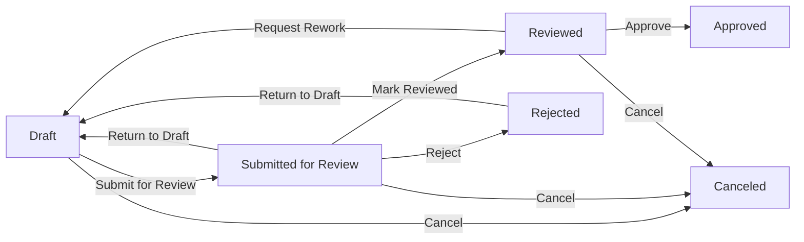
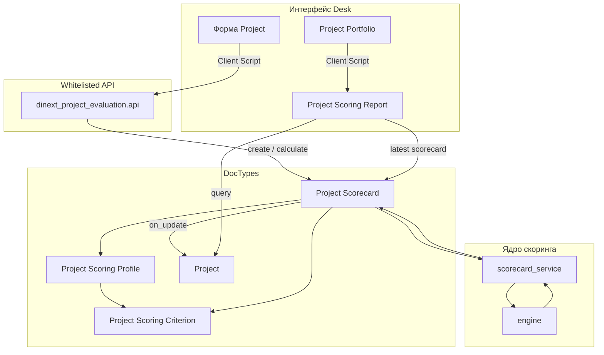

# Dinext Project Evaluation

## 📖 Обзор

**Dinext Project Evaluation** — приложение Frappe/ERPNext для формализованного скоринга проектов, scorecard-документов и аналитики портфеля поверх стандартных ERPNext Projects. PMO и менеджеры проектов могут задавать критерии и профили оценки, заполнять scorecard по стадиям проекта, рассчитывать взвешенный интегральный балл с правилами «ворот» и сравнивать проекты в Script Report с пузырьковой диаграммой.

Приложение интегрируется с существующим управлением проектами Dinext (Project Portfolio, Project Stage, stage-gate) и не заменяет модуль stage-gate. При установке автоматически создаются типовые критерии и стартовый профиль оценки.

## ✨ Возможности

- **Каталог критериев скоринга** — числовые, валютные, процентные, логические и качественные (шкала) значения с направлением влияния и опциональными шкалами Likert.
- **Профили оценки** — веса, обязательность критериев, пороги gate по обязательным критериям (нормализованный балл и/или сырое число), применимость по стадиям; в UI показываются только релевантные пороговые поля.
- **Project Scorecard** — типовой Frappe Workflow **Dinext Project Scorecard Approval** (отдельные роли согласования, не stage-gate), снимок профиля, расчёт интегрального балла и gate; проверка mandatory-критериев при уходе из Draft. Подробнее — раздел [Workflow согласования](#workflow-согласования-project-scorecard).
- **UI карточки Project** — Client Script: создание scorecard, история оценок, переход к отчёту портфеля.
- **UI Project Portfolio** — переход к отчёту скоринга и пузырьковой диаграмме для выбранного портфеля.
- **Project Scoring Report** — фильтры по портфелю, проекту, профилю и стадии; таблица данных, bubble payload на сервере и SVG-диаграмма на клиенте.
- **Seed-данные по умолчанию** — типовые критерии (стратегическое соответствие, финансовая выгода и др.) и `Default Project Scoring Profile` согласно [docs/2026-04-28-project-scoring-architecture-and-task.md](docs/2026-04-28-project-scoring-architecture-and-task.md).
- **Чистый scoring engine** — модуль расчёта без зависимости от Frappe ORM и unit-тесты нормализации, взвешивания и gate-логики.

## 🚀 Установка

Установка через [bench](https://github.com/frappe/bench):

```bash
cd $PATH_TO_YOUR_BENCH
bench get-app $URL_OF_THIS_REPO --branch develop
bench --site <site> install-app dinext_project_evaluation
bench --site <site> migrate
```

Хук `after_install` вызывает `seed_default_scoring_model` и создаёт критерии и профиль по умолчанию.

Повторный seed на уже установленном сайте (идемпотентно):

```bash
bench --site <site> execute dinext_project_evaluation.seed.seed_default_scoring_model
bench --site <site> export-fixtures
```

После изменений метаданных, workflow или seed экспортируйте fixtures в репозиторий (`dinext_project_evaluation/fixtures/`):

```bash
bench --site <site> export-fixtures
```

При `migrate` подтягиваются fixtures, в том числе workflow **Dinext Project Scorecard Approval**, роли scorecard-согласования и `Default Project Scoring Profile`. Патч `migrate_scorecard_calculated_status` переводит устаревший статус `Calculated` в `Reviewed`.

## Workflow согласования Project Scorecard

Жизненный цикл scorecard управляется workflow Frappe с полем состояния **`status`** (не submittable DocType). Статус на форме только для чтения; переходы — кнопками workflow на форме **Project Scorecard**.

**Workflow:** `Dinext Project Scorecard Approval`  
**Источник в репозитории:** `dinext_project_evaluation/fixtures/workflow.json`, `workflow_state.json`, `workflow_action_master.json`, `role.json`

### Роли (отдельно от stage-gate)

| Роль | Назначение |
|------|------------|
| **Project Scorecard Author** | Создаёт scorecard, заполняет критерии в Draft, отправляет на проверку |
| **Project Scorecard Reviewer** | Проверяет полноту, переводит в Reviewed или возвращает на доработку |
| **Project Scorecard Approver** | Утверждает итоговую оценку (Reviewed → Approved) |
| **Project Scorecard Admin** | Отмена процесса (Cancel), полный доступ к DocType |

Рекомендуемое соответствие существующим ролям Dinext (см. `scoring/workflow_constants.py`):

| Роль Dinext | Роль scorecard |
|-------------|----------------|
| `Dinext_Project_Manager` | Project Scorecard Author |
| `Project Governance Admin` | Project Scorecard Admin |

Пользователям нужно выдать соответствующие роли scorecard в **User** (помимо прав на Project / портфель). Stage-gate роли (`Stage Gate Owner`, `Reviewer`, `Approver`) в workflow scorecard **не** используются.

### Статусы и расчёт

| Статус | Смысл | Расчёт integral / gate | В отчёте портфеля |
|--------|--------|------------------------|-------------------|
| Draft | Черновик, ввод значений | Нет | Нет |
| Submitted for Review | На проверке | Нет | Нет |
| Reviewed | Проверка пройдена | Да (при save) | Да |
| Approved | Утверждено | Да (при save) | Да |
| Rejected | Возврат на доработку | Нет | Нет |
| Canceled | Процесс прекращён | Нет | Нет |

Утверждённые и отменённые scorecard нельзя редактировать (нужен новый scorecard). Уникальность: один неотменённый scorecard на `stage_instance_at_evaluation`.

### Переходы workflow

| Из | Действие | В | Кто |
|----|----------|---|-----|
| Draft | Submit for Review | Submitted for Review | Author |
| Draft | Cancel | Canceled | Admin |
| Submitted for Review | Return to Draft | Draft | Reviewer |
| Submitted for Review | Mark Reviewed | Reviewed | Reviewer |
| Submitted for Review | Reject | Rejected | Reviewer |
| Submitted for Review | Cancel | Canceled | Admin |
| Reviewed | Request Rework | Draft | Reviewer / Approver |
| Reviewed | Approve | Approved | Approver |
| Reviewed | Reject | Rejected | Approver |
| Reviewed | Cancel | Canceled | Admin |
| Rejected | Return to Draft | Draft | Author |



### Разработка метаданных workflow

По политике Dinext: workflow, роли и состояния создаются в системе (MCP / Desk), затем выгружаются:

```bash
bench --site <site> migrate
bench --site <site> export-fixtures
```

Не правьте `fixtures/workflow*.json` и `role.json` вручную — только через экспорт после изменений на сайте.

## 🛠️ Использование

### В интерфейсе Desk

1. Откройте **Project Scoring Criterion** и **Project Scoring Profile** — просмотр или расширение каталога (либо используйте seed по умолчанию).
2. В **Project Scoring Profile** для каждой строки критерия задайте вес, обязательность и при необходимости пороги gate:
   - **Desired** — пороговые поля скрыты; gate не проверяется.
   - **Mandatory + шкала/да-нет** — доступен только **Minimum Normalized Score** (0…1).
   - **Mandatory + Number/Currency/Percent** — доступны normalized score и **Minimum/Maximum Raw Value**.
   - Неактуальные пороги автоматически очищаются при изменении строки и при сохранении профиля; при открытии формы выполняется только скрытие/показ полей.
3. На форме **Project** — действия оценки (Client Script): создать scorecard для текущей стадии и профиля.
4. Заполните строки scorecard в статусе **Draft**. При переходе в любой другой статус (кроме **Canceled**) сервер и форма проверяют, что все **Mandatory**-критерии заполнены; незаполненные ячейки подсвечиваются в колонке **Value**.
5. Переведите scorecard по workflow: **Submit for Review** → **Mark Reviewed** (расчёт интегрального балла и gate) → **Approve**. Утверждённые scorecard обновляют денормализованные поля Project.
6. Из **Project Portfolio** откройте **Project Scoring Report** для сравнения проектов и пузырьковой диаграммы.
7. В отчёте используйте фильтры: портфель, проект, профиль, стадия.

### Валидация обязательных критериев (Mandatory)

При переходе **Project Scorecard** из статуса **Draft** в любой другой (кроме **Canceled**):

- **Сервер** (`project_scorecard.py`): после sync строк и подготовки вводов вызывается `calculate_scorecard_document()`; если для mandatory-критерия нет значения, сохранение блокируется с сообщением вида «Fill mandatory evaluation criteria before changing status: …».
- **Клиент** (`project_scorecard.js`): перед сохранением выполняется та же проверка по applicable criteria профиля; незаполненные ячейки колонки **Value** подсвечиваются классом `invalid`; подсветка снимается после ввода значения.
- Переход **Draft → Canceled** не требует заполнения mandatory-критериев.
- Обязательность определяется полем **Requirement Level** в строках **Project Scoring Profile**, а не статическим `reqd` в DocType child table.

### Whitelisted API (Client Scripts и интеграции)

| Метод | Назначение |
|-------|------------|
| `dinext_project_evaluation.api.get_applicable_criteria` | Критерии для проекта и профиля с учётом стадии (`stage` опционален; по умолчанию — текущая стадия Project) |
| `dinext_project_evaluation.api.create_scorecard` | Создание черновика scorecard с применимыми строками |
| `dinext_project_evaluation.api.calculate_scorecard` | Workflow-переход к **Reviewed** (Submit for Review + Mark Reviewed) с пересчётом баллов |
| `dinext_project_evaluation.api.approve_scorecard` | Workflow-утверждение scorecard и обновление денормализованных полей Project |
| `dinext_project_evaluation.api.get_scorecard_history` | Список scorecard по проекту |

Пример (bench console):

```bash
bench --site <site> execute dinext_project_evaluation.seed.seed_default_scoring_model
```

### Проверка

```bash
cd apps/dinext_project_evaluation
python3 -m unittest \
  dinext_project_evaluation.tests.test_gate_fields \
  dinext_project_evaluation.tests.test_scoring_engine \
  dinext_project_evaluation.tests.test_scorecard_service \
  dinext_project_evaluation.dinext_project_evaluation.doctype.project_scorecard.test_project_scorecard

bench --site <site> run-tests --app dinext_project_evaluation \
  --module dinext_project_evaluation.tests.test_scorecard_service \
  --module dinext_project_evaluation.dinext_project_evaluation.doctype.project_scorecard.test_project_scorecard
```

Сценарии приёмки описаны в [docs/2026-04-28-project-scoring-architecture-and-task.md](docs/2026-04-28-project-scoring-architecture-and-task.md).

## 📦 Технологии

- **Python 3.10+** — scoring engine, контроллеры DocType, backend Script Report, whitelisted API
- **Frappe Framework / ERPNext** — DocTypes, fixtures, Client Scripts, Query Report
- **JavaScript** — Client Scripts (Project, Project Portfolio), отрисовка bubble chart в отчёте
- **Ruff, ESLint, Prettier** — линтинг и форматирование через pre-commit

## 🔧 Конфигурация

| Расположение | Назначение |
|--------------|------------|
| `dinext_project_evaluation/hooks.py` | `required_apps`, `fixtures`, `after_install` |
| `dinext_project_evaluation/fixtures/` | Экспорт Client Scripts, Custom Fields, критериев, профилей, Report |
| `dinext_project_evaluation/seed.py` | Коды критериев по умолчанию, шкалы, веса профиля, пороги gate для обязательных критериев |
| `dinext_project_evaluation/scoring/gate_fields.py` | Релевантность и очистка порогов gate в строках профиля |
| `dinext_project_evaluation/scoring/workflow_constants.py` | Статусы, роли и действия workflow Project Scorecard |
| `dinext_project_evaluation/scoring/workflow.py` | Whitelisted workflow-переходы (calculate / approve) |
| `dinext_project_evaluation/dinext_project_evaluation/doctype/project_scoring_profile/project_scoring_profile.js` | Условная видимость порогов gate в форме профиля |
| `dinext_project_evaluation/dinext_project_evaluation/doctype/project_scorecard/project_scorecard.js` | Grid ввода значений критериев, валидация mandatory при уходе из Draft, подсветка ячеек |
| `dinext_project_evaluation/translations/ru.csv` | Русские переводы |

Fixtures из `hooks.py` экспортируют:

- `project_scoring_criterion_group.json`, `project_scoring_criterion.json`, `project_scoring_profile.json`;
- `client_script.json`, `report.json`, `custom_field.json`;
- `role.json` — Project Scorecard Author / Reviewer / Approver / Admin;
- `workflow.json`, `workflow_state.json`, `workflow_action_master.json` — **Dinext Project Scorecard Approval**.

Отдельные переменные окружения не требуются — достаточно стандартного bench-сайта с ERPNext.

## ✅ Требования

- Frappe bench с установленным **ERPNext** (`required_apps = ["erpnext"]`)
- Python **>= 3.10**
- Расширения Dinext на сайте: **Project Portfolio**, **Project Stage** и поля stage instance на Project (используются при заполнении scorecard)
- Для разработки: [pre-commit](https://pre-commit.com/#installation)

## 🤝 Участие в разработке

В репозитории настроен pre-commit:

```bash
cd apps/dinext_project_evaluation
pre-commit install
```

Инструменты: ruff, eslint, prettier, pyupgrade.

Конвенции агентов и shared-политики Dinext: [AGENTS.md](AGENTS.md) и central-репозиторий `dinext-docs`.

## Подключение к dinext-docs

Приложение подключено к central Dinext consumer-контракту:

1. **Sibling-path:** `../dinext-docs/` (layout `frappe-bench/apps/<app>/` рядом с `dinext-docs`).
2. **Agent navigation:** [AGENTS.md](AGENTS.md) — navigation stub; shared skills/rules читаются из `../dinext-docs/agents/`.
3. **Doc-intake:** после commit локальный `post-commit` hook создаёт proposal в `../dinext-docs/doc-proposals/inbox/` (установка: `python3 ../dinext-docs/scripts/install_doc_intake_hooks.py --docs-root ../dinext-docs --app-root . --apply`).
4. **Пользовательская документация:** изменения маршрутизируются в central repo через doc-proposals, а не прямой правкой `dinext-docs/docs/`.

## 📄 Документация

| Документ | Описание |
|----------|----------|
| [docs/2026-04-28-project-scoring-architecture-and-task.md](docs/2026-04-28-project-scoring-architecture-and-task.md) | Архитектура, модель данных, правила расчёта, UX, приёмка |
| [sources/pdfs/md/](sources/pdfs/md/) | Справочные материалы (скоринговые модели, управление портфелем) |
| [AGENTS.md](AGENTS.md) | Навигация агента Dinext и порядок загрузки central docs |

## ❤️ Благодарности

Приложение разработано для экосистемы Dinext на ERPNext/Frappe. Концепции скоринга опираются на материалы по управлению портфелем и stage-gate в каталоге `sources/pdfs/md/`.

## 📝 Changelog

| Commit | Кратко |
|--------|--------|
| *(текущая ветка)* | Валидация mandatory-критериев при уходе из Draft; workflow Project Scorecard; подсветка ячеек в grid |
| `089e159` | Выравнивание с Dinext: зависимость erpnext, AGENTS.md |
| `c448318` | Инициализация каркаса приложения |

## 🗂️ Структура репозитория

```
dinext_project_evaluation/
├── AGENTS.md                          # stub агента Dinext → central dinext-docs
├── README.md
├── pyproject.toml                     # метаданные пакета, конфиг ruff
├── docs/
│   └── 2026-04-28-project-scoring-architecture-and-task.md
├── sources/pdfs/md/                   # справочные PDF (markdown)
└── dinext_project_evaluation/
    ├── hooks.py                       # fixtures, after_install, required_apps
    ├── api.py                         # whitelisted API scorecard
    ├── install.py                     # post-install hook
    ├── seed.py                        # seed критериев и профиля по умолчанию
    ├── scoring/
    │   ├── engine.py                  # чистые расчёты (unit-тесты)
    │   ├── gate_fields.py             # релевантность и sanitize порогов gate
    │   ├── scorecard_service.py       # адаптер Frappe document ↔ engine
    │   ├── scorecard_factory.py       # создание/sync строк scorecard из профиля
    │   ├── scorecard_provision.py     # автосоздание Draft по stage instance
    │   ├── workflow_constants.py      # статусы, роли, действия workflow
    │   └── workflow.py                # workflow-переходы calculate / approve
    ├── tests/
    │   ├── test_gate_fields.py
    │   ├── test_scoring_engine.py
    │   ├── test_scorecard_service.py
    │   └── test_scorecard_factory.py
    ├── fixtures/                      # вывод bench export-fixtures (+ workflow)
    ├── translations/ru.csv
    └── dinext_project_evaluation/
        ├── doctype/                   # DocTypes скоринга + Project Scorecard
        └── report/
            └── project_scoring_report/  # Script Report + JS bubble chart
```

| Путь | Назначение |
|------|------------|
| `scoring/engine.py` | Нормализация вводов, веса, правила gate |
| `scoring/gate_fields.py` | Какие пороги gate допустимы для строки профиля; очистка неактуальных значений |
| `scoring/scorecard_service.py` | Преобразование строк Scorecard в входные данные engine; `missing_mandatory_criterion_codes()` |
| `scoring/workflow.py` | Workflow-переходы scorecard (Submit for Review, Mark Reviewed, Approve) |
| `doctype/project_scorecard/` | Workflow, расчёт при save, проверка mandatory при уходе из Draft, обновление Project |
| `doctype/project_scorecard/project_scorecard.js` | Grid ввода значений, client-side валидация и подсветка mandatory-ячеек |
| `doctype/project_scoring_*` | Критерии, шкалы, профили, строки профиля с опциональной стадией и порогами gate |
| `doctype/project_scoring_profile/project_scoring_profile.js` | Условное отображение порогов gate по обязательности и типу критерия |
| `report/project_scoring_report/` | Аналитика портфеля и bubble payload |
| `fixtures/` | Версионируемые метаданные и seed для migrate/install |

## 🔗 Схема потоков



**Поток данных (scorecard):** создаётся **Draft** (вручную, API или при Active **Project Stage Instance**) → заполнение критериев → workflow **Submit for Review** → **Mark Reviewed** (расчёт) → **Approve** → обновление `custom_last_*` на **Project**. **Project Scoring Report** берёт последний scorecard со статусом **Reviewed** или **Approved**.

**Поток валидации:** при любом уходе из **Draft**, кроме **Canceled**, сервер и форма требуют заполнения mandatory-критериев (см. раздел «Валидация обязательных критериев»).

## Лицензия

MIT
