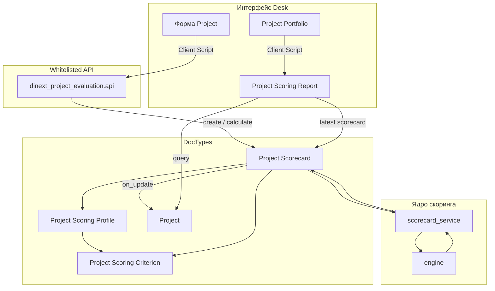

# Dinext Project Evaluation

## 📖 Обзор

**Dinext Project Evaluation** — приложение Frappe/ERPNext для формализованного скоринга проектов, scorecard-документов и аналитики портфеля поверх стандартных ERPNext Projects. PMO и менеджеры проектов могут задавать критерии и профили оценки, заполнять scorecard по стадиям проекта, рассчитывать взвешенный интегральный балл с правилами «ворот» и сравнивать проекты в Script Report с пузырьковой диаграммой.

Приложение интегрируется с существующим управлением проектами Dinext (Project Portfolio, Project Stage, stage-gate) и не заменяет модуль stage-gate. При установке автоматически создаются типовые критерии и стартовый профиль оценки.

## ✨ Возможности

- **Каталог критериев скоринга** — числовые, валютные, процентные, логические и качественные (шкала) значения с направлением влияния и опциональными шкалами Likert.
- **Профили оценки** — веса, обязательность критериев, пороги интегральной оценки, правила gate и применимость по стадиям.
- **Project Scorecard** — жизненный цикл Draft/Approved, снимок профиля, нормализованные баллы по критериям, интегральная оценка и результат прохождения «ворот».
- **UI карточки Project** — Client Script: создание scorecard, история оценок, переход к отчёту портфеля.
- **UI Project Portfolio** — переход к отчёту скоринга и пузырьковой диаграмме для выбранного портфеля.
- **Project Scoring Report** — фильтры по портфелю, проекту, профилю и стадии; таблица данных, bubble payload на сервере и SVG-диаграмма на клиенте.
- **Seed-данные по умолчанию** — типовые критерии (стратегическое соответствие, финансовая выгода и др.) и `Default Project Scoring Profile` согласно [docs/2026-04-28-project-scoring-architecture-and-task.md](docs/2026-04-28-project-scoring-architecture-and-task.md).
- **Чистый scoring engine** — модуль расчёта без зависимости от Frappe ORM и unit-тесты нормализации, взвешивания и gate-логики.

## 🚀 Установка

Установка через [bench](https://github.com/frappe/bench):

```bash
cd $PATH_TO_YOUR_BENCH
bench get-app $URL_OF_THIS_REPO --branch develop
bench --site <site> install-app dinext_project_evaluation
bench --site <site> migrate
```

Хук `after_install` вызывает `seed_default_scoring_model` и создаёт критерии и профиль по умолчанию.

Повторный seed на уже установленном сайте (идемпотентно):

```bash
bench --site <site> execute dinext_project_evaluation.seed.seed_default_scoring_model
bench --site <site> export-fixtures
```

После изменений метаданных или seed экспортируйте fixtures в репозиторий (`dinext_project_evaluation/fixtures/`):

```bash
bench --site <site> export-fixtures
```

## 🛠️ Использование

### В интерфейсе Desk

1. Откройте **Project Scoring Criterion** и **Project Scoring Profile** — просмотр или расширение каталога (либо используйте seed по умолчанию).
2. На форме **Project** — действия оценки (Client Script): создать scorecard для текущей стадии и профиля.
3. Заполните строки scorecard, сохраните для пересчёта интегрального балла и gate, затем утвердите документ.
4. Из **Project Portfolio** откройте **Project Scoring Report** для сравнения проектов и пузырьковой диаграммы.
5. В отчёте используйте фильтры: портфель, проект, профиль, стадия.

### Whitelisted API (Client Scripts и интеграции)

| Метод | Назначение |
|-------|------------|
| `dinext_project_evaluation.api.get_applicable_criteria` | Критерии для проекта и профиля с учётом текущей стадии |
| `dinext_project_evaluation.api.create_scorecard` | Создание черновика scorecard с применимыми строками |
| `dinext_project_evaluation.api.calculate_scorecard` | Пересчёт баллов существующего scorecard |
| `dinext_project_evaluation.api.approve_scorecard` | Утверждение scorecard и обновление денормализованных полей Project |
| `dinext_project_evaluation.api.get_scorecard_history` | Список scorecard по проекту |

Пример (bench console):

```bash
bench --site <site> execute dinext_project_evaluation.seed.seed_default_scoring_model
```

### Проверка

```bash
cd apps/dinext_project_evaluation
python3 -m unittest \
  dinext_project_evaluation.tests.test_scoring_engine \
  dinext_project_evaluation.tests.test_scorecard_service

bench --site <site> migrate
bench --site <site> execute frappe.desk.query_report.run \
  --kwargs '{"report_name":"Project Scoring Report","filters":{}}'
```

Сценарии приёмки описаны в [docs/2026-04-28-project-scoring-architecture-and-task.md](docs/2026-04-28-project-scoring-architecture-and-task.md).

## 📦 Технологии

- **Python 3.10+** — scoring engine, контроллеры DocType, backend Script Report, whitelisted API
- **Frappe Framework / ERPNext** — DocTypes, fixtures, Client Scripts, Query Report
- **JavaScript** — Client Scripts (Project, Project Portfolio), отрисовка bubble chart в отчёте
- **Ruff, ESLint, Prettier** — линтинг и форматирование через pre-commit

## 🔧 Конфигурация

| Расположение | Назначение |
|--------------|------------|
| `dinext_project_evaluation/hooks.py` | `required_apps`, `fixtures`, `after_install` |
| `dinext_project_evaluation/fixtures/` | Экспорт Client Scripts, Custom Fields, критериев, профилей, Report |
| `dinext_project_evaluation/seed.py` | Коды критериев по умолчанию, шкалы, веса профиля |
| `dinext_project_evaluation/translations/ru.csv` | Русские переводы |

Fixtures из `hooks.py` экспортируют:

- справочники Project Scoring Criterion / Profile;
- Client Scripts (модуль Dinext Project Evaluation, enabled);
- отчёт Project Scoring Report;
- Custom Fields на Project (модуль Dinext Project Evaluation).

Отдельные переменные окружения не требуются — достаточно стандартного bench-сайта с ERPNext.

## ✅ Требования

- Administrator с установленным **ERPNext** (`required_apps = ["erpnext"]`)
- Python **>= 3.10**
- Расширения Dinext на сайте: **Project Portfolio**, **Project Stage** и поля stage instance на Project (используются при заполнении scorecard)
- Для разработки: [pre-commit](https://pre-commit.com/#installation)

## 🤝 Участие в разработке

В репозитории настроен pre-commit:

```bash
cd apps/dinext_project_evaluation
pre-commit install
```

Инструменты: ruff, eslint, prettier, pyupgrade.

Конвенции агентов и shared-политики Dinext: [AGENTS.md](AGENTS.md) и central-репозиторий `dinext-docs`.

## Подключение к dinext-docs

Приложение подключено к central Dinext consumer-контракту:

1. **Sibling-path:** `../dinext-docs/` (layout `frappe-bench/apps/<app>/` рядом с `dinext-docs`).
2. **Agent navigation:** [AGENTS.md](AGENTS.md) — navigation stub; shared skills/rules читаются из `../dinext-docs/agents/`.
3. **Doc-intake:** после commit локальный `post-commit` hook создаёт proposal в `../dinext-docs/doc-proposals/inbox/` (установка: `python3 ../dinext-docs/scripts/install_doc_intake_hooks.py --docs-root ../dinext-docs --app-root . --apply`).
4. **Пользовательская документация:** изменения маршрутизируются в central repo через doc-proposals, а не прямой правкой `dinext-docs/docs/`.

## 📄 Документация

| Документ | Описание |
|----------|----------|
| [docs/2026-04-28-project-scoring-architecture-and-task.md](docs/2026-04-28-project-scoring-architecture-and-task.md) | Архитектура, модель данных, правила расчёта, UX, приёмка |
| [sources/pdfs/md/](sources/pdfs/md/) | Справочные материалы (скоринговые модели, управление портфелем) |
| [AGENTS.md](AGENTS.md) | Навигация агента Dinext и порядок загрузки central docs |

## ❤️ Благодарности

Приложение разработано для экосистемы Dinext на ERPNext/Frappe. Концепции скоринга опираются на материалы по управлению портфелем и stage-gate в каталоге `sources/pdfs/md/`.

## 📝 Changelog

| Commit | Кратко |
|--------|--------|
| `089e159` | Выравнивание с Dinext: зависимость erpnext, AGENTS.md |
| `c448318` | Инициализация каркаса приложения |

*(Незакоммиченная работа: полный модуль скоринга — DocTypes, engine, API, seed, UI, отчёт.)*

## 🗂️ Структура репозитория

```
dinext_project_evaluation/
├── AGENTS.md                          # stub агента Dinext → central dinext-docs
├── README.md
├── pyproject.toml                     # метаданные пакета, конфиг ruff
├── docs/
│   └── 2026-04-28-project-scoring-architecture-and-task.md
├── sources/pdfs/md/                   # справочные PDF (markdown)
└── dinext_project_evaluation/
    ├── hooks.py                       # fixtures, after_install, required_apps
    ├── api.py                         # whitelisted API scorecard
    ├── install.py                     # post-install hook
    ├── seed.py                        # seed критериев и профиля по умолчанию
    ├── scoring/
    │   ├── engine.py                  # чистые расчёты (unit-тесты)
    │   └── scorecard_service.py       # адаптер Frappe document ↔ engine
    ├── tests/
    │   ├── test_scoring_engine.py
    │   └── test_scorecard_service.py
    ├── fixtures/                      # вывод bench export-fixtures
    ├── translations/ru.csv
    └── dinext_project_evaluation/
        ├── doctype/                   # DocTypes скоринга + Project Scorecard
        └── report/
            └── project_scoring_report/  # Script Report + JS bubble chart
```

| Путь | Назначение |
|------|------------|
| `scoring/engine.py` | Нормализация вводов, веса, правила gate |
| `scoring/scorecard_service.py` | Преобразование строк Scorecard в входные данные engine |
| `doctype/project_scorecard/` | Жизненный цикл, расчёт при save, обновление полей Project |
| `doctype/project_scoring_*` | Критерии, шкалы, профили, строки профиля |
| `report/project_scoring_report/` | Аналитика портфеля и bubble payload |
| `fixtures/` | Версионируемые метаданные и seed для migrate/install |

## 🔗 Схема потоков



**Поток данных (сохранение scorecard):** клиент или API создаёт/обновляет **Project Scorecard** → контроллер вызывает **scorecard_service** → **engine** считает нормализованные баллы по критериям, интегральную оценку и gate → результаты записываются в строки и заголовок scorecard → утверждённые scorecard обновляют денормализованные поля **Project** → **Project Scoring Report** читает проекты и последние scorecard для таблицы и bubble chart.

## Лицензия

MIT
