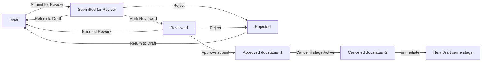
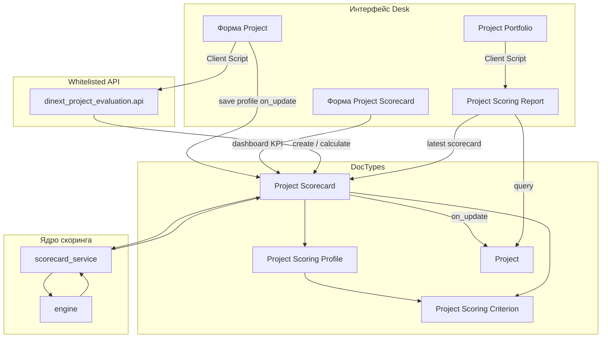

# Dinext Project Evaluation

## 📖 Обзор

**Dinext Project Evaluation** — приложение Frappe/ERPNext для формализованного скоринга проектов, scorecard-документов и аналитики портфеля поверх стандартных ERPNext Projects. PMO и менеджеры проектов могут задавать критерии и профили оценки, заполнять scorecard по стадиям проекта, рассчитывать взвешенный интегральный балл с правилами «ворот» и сравнивать проекты в Script Report с пузырьковой диаграммой.

Приложение интегрируется с существующим управлением проектами Dinext (Project Portfolio, Project Stage, stage-gate) и не заменяет модуль stage-gate. При установке автоматически создаются типовые критерии и стартовый профиль оценки.

## ✨ Возможности

- **Каталог критериев скоринга** — числовые, валютные, процентные, логические и качественные (шкала) значения с направлением влияния и опциональными шкалами Likert.
- **Профили оценки** — веса, обязательность критериев, пороги gate по обязательным критериям (нормализованный балл и/или сырое число), применимость по стадиям; в UI показываются только релевантные пороговые поля.
- **Project Scorecard** — submittable DocType с workflow **Dinext Project Scorecard Approval** (отдельные роли согласования, не stage-gate), снимок профиля, расчёт интегрального балла и gate; проверка mandatory-критериев при уходе из Draft. **Dashboard KPI** на форме scorecard: компактные блоки **Integral Score**, **Gate Pass** и **Last Recalculated** в `frm.dashboard` после расчёта (секция «Evaluation Summary»); ручной пересчёт через пункт меню **Recalculate Score**. **Согласованной** считается только submitted-оценка (`docstatus = 1`); поле `status` остаётся бизнес-индикатором для UI. Подробнее — раздел [Workflow согласования](#workflow-согласования-project-scorecard) и [Dashboard KPI на форме Project Scorecard](#dashboard-kpi-на-форме-project-scorecard).
- **Автосоздание Draft scorecard** — при назначении профиля оценки проекту с активной стадией или при переходе **Project Stage Instance** в статус **Active** (если на проекте уже задан профиль); идемпотентно, без дубликатов на одну stage instance.
- **UI карточки Project** — form script (`project_scoring_evaluation.js`): выбор профиля оценки (только при заданной Governance Model), кнопки **Open Scorecards** / **Open Scoring Report** в меню Evaluation, переход к отчёту портфеля; сброс профиля при смене/очистке модели управления.
- **UI Project Portfolio** — переход к отчёту скоринга и пузырьковой диаграмме для выбранного портфеля.
- **Project Scoring Report** — фильтры по портфелю, проекту, профилю и стадии; в выборку попадают submitted scorecard (`docstatus = 1`); таблица данных, bubble payload на сервере и SVG-диаграмма на клиенте.
- **Seed-данные по умолчанию** — типовые критерии (стратегическое соответствие, финансовая выгода и др.) и `Default Project Scoring Profile` согласно [docs/2026-04-28-project-scoring-architecture-and-task.md](docs/2026-04-28-project-scoring-architecture-and-task.md).
- **Чистый scoring engine** — модуль расчёта без зависимости от Frappe ORM и unit-тесты нормализации, взвешивания и gate-логики.
- **Интеграция со Stage Gate** — флаг **Require Agreed Stage Scorecard** на `Stage Gate Template`; при включении checkpoint нельзя отправить в **In Review** без submitted scorecard (`docstatus = 1`) для той же `Project Stage Instance`. На форме `Project Gate Checkpoint` показываются ссылка на scorecard, интегральный балл и предупреждение о непройденных gate-порогах (мягкое предупреждение, не блокирует review). Подробнее — [Интеграция Stage Gate и scorecard](#интеграция-stage-gate-и-scorecard).

## 🚀 Установка

Установка через [bench](https://github.com/frappe/bench):

```bash
cd $PATH_TO_YOUR_BENCH
bench get-app $URL_OF_THIS_REPO --branch develop
bench --site <site> install-app dinext_project_evaluation
bench --site <site> migrate
```

Хук `after_install` вызывает `seed_default_scoring_model` и создаёт критерии и профиль по умолчанию.

Повторный seed на уже установленном сайте (идемпотентно):

```bash
bench --site <site> execute dinext_project_evaluation.seed.seed_default_scoring_model
bench --site <site> export-fixtures
```

После изменений метаданных, workflow или seed экспортируйте fixtures в репозиторий (`dinext_project_evaluation/fixtures/`):

```bash
bench --site <site> export-fixtures
```

При `migrate` подтягиваются fixtures, в том числе workflow **Dinext Project Scorecard Approval**, роли scorecard-согласования и `Default Project Scoring Profile`. Патчи:

- `migrate_scorecard_calculated_status` — устаревший статус `Calculated` → `Reviewed`;
- `migrate_scorecard_submittable` — backfill `docstatus` для существующих scorecard (`Approved` → submitted, `Canceled` → cancelled);
- `migrate_checkpoint_require_agreed_scorecard_snapshot` — backfill snapshot-флага `require_agreed_stage_scorecard` на существующие checkpoint из текущих шаблонов;
- `migrate_checkpoint_scorecard_summary_backfill` — пересинхронизация `linked_stage_scorecard` и summary-полей на существующих checkpoint.

## Workflow согласования Project Scorecard

Жизненный цикл scorecard управляется **Frappe Workflow** с полем состояния **`status`** и стандартным **`docstatus`** submittable-документа. Статус на форме только для чтения; переходы — кнопками workflow на форме **Project Scorecard**.

**Workflow:** `Dinext Project Scorecard Approval`  
**Источник в репозитории:** `dinext_project_evaluation/fixtures/workflow.json`, `workflow_state.json`, `workflow_action_master.json`, `role.json`

### Submittable lifecycle и «согласованная» оценка

| Понятие | Источник истины | Примечание |
|---------|-----------------|------------|
| Бизнес-статус (Draft, Reviewed, Approved…) | поле `status` | UI, роли редактирования, расчёт integral/gate |
| Согласованная / финальная оценка | **`docstatus = 1`** | Отчёт портфеля, `custom_last_*` на Project, gate downstream |
| Отменённая оценка | `status = Canceled` и **`docstatus = 2`** | Не блокирует новую карточку для стадии |

Переход **Reviewed → Approved** через workflow вызывает `doc.submit()` (состояние Approved в workflow имеет `doc_status = 1`). Отмена submitted scorecard — через workflow **Cancel** (Approved → Canceled) или программный cancel для черновиков в промежуточных статусах.

### Роли (отдельно от stage-gate)

| Роль | Назначение |
|------|------------|
| **Project Scorecard Author** | Создаёт scorecard, заполняет критерии в Draft, отправляет на проверку |
| **Project Scorecard Reviewer** | Проверяет полноту, переводит в Reviewed или возвращает на доработку |
| **Project Scorecard Approver** | Утверждает оценку (Reviewed → Approved), **отменяет** scorecard (Cancel) |
| **Project Scorecard Admin** | Полный доступ к DocType; submit без права cancel |

Рекомендуемое соответствие существующим ролям Dinext (см. `scoring/workflow_constants.py`):

| Роль Dinext | Роль scorecard |
|-------------|----------------|
| `Dinext_Project_Manager` | Project Scorecard Author |
| `Project Governance Admin` | Project Scorecard Admin |

Пользователям нужно выдать соответствующие роли scorecard в **User** (помимо прав на Project / портфель). Stage-gate роли (`Stage Gate Owner`, `Reviewer`, `Approver`) в workflow scorecard **не** используются.

### Статусы, docstatus и расчёт

| Статус (`status`) | `docstatus` | Смысл | Расчёт integral / gate | В отчёте портфеля |
|-------------------|-------------|--------|------------------------|-------------------|
| Draft | 0 | Черновик, ввод значений | Нет | Нет |
| Submitted for Review | 0 | На проверке | Да (при save) | Нет |
| Reviewed | 0 | Проверка пройдена | Да (при save, пересчёт) | Нет |
| Approved | **1** | Утверждено (submitted) | Да (при save) | **Да** |
| Rejected | 0 | Возврат на доработку | Нет | Нет |
| Canceled | **2** | Процесс прекращён | Нет | Нет |

Ручное редактирование значений критериев и комментариев допускается только в **Draft**; во всех остальных статусах разрешены workflow-переходы и системный пересчёт, но не правка содержимого. Утверждённые и отменённые scorecard нельзя переводить обратно в более ранние статусы.

### Уникальность и replacement после Cancel

- На одну **`stage_instance_at_evaluation`** допускается **не более одного** scorecard со статусом, отличным от **Canceled** (включая Draft и Rejected — повторное создание не дублирует карточку, а переиспользует существующую).
- После **Cancel** для стадии **немедленно** создаётся новый **Draft** с тем же проектом, профилем и `stage_instance_at_evaluation` (если стадия ещё **Active** и карточки для неё нет).
- **Cancel** разрешён только пользователю с ролью **Project Scorecard Approver** и только пока связанная **Project Stage Instance** в статусе **Active**. Кнопка Cancel в UI скрывается workflow-условием на переходе Approved → Canceled; серверная проверка дублируется в `before_cancel()`.

### Переходы workflow

| Из | Действие | В | Кто | Примечание |
|----|----------|---|-----|------------|
| Draft | Submit for Review | Submitted for Review | Author | Расчёт integral / gate |
| Submitted for Review | Return to Draft | Draft | Reviewer | |
| Submitted for Review | Mark Reviewed | Reviewed | Reviewer | |
| Submitted for Review | Reject | Rejected | Reviewer | |
| Reviewed | Request Rework | Draft | Reviewer / Approver | |
| Reviewed | Approve | Approved | Approver | `doc.submit()` |
| Reviewed | Reject | Rejected | Approver | |
| Rejected | Return to Draft | Draft | Author | |
| Approved | Cancel | Canceled | Approver | Только если stage instance **Active**; `doc.cancel()` |

Отмена из **Draft / Submitted / Reviewed / Rejected** не оформлена workflow-переходом (ограничение Frappe: нельзя `docstatus 0 → 2` через workflow). Такие случаи обрабатывает `scoring/scorecard_cancel.py` (программный cancel + replacement draft).



### Разработка метаданных workflow

По политике Dinext: workflow, роли и состояния создаются в системе (MCP / Desk), затем выгружаются:

```bash
bench --site <site> migrate
bench --site <site> export-fixtures
```

Не правьте `fixtures/workflow*.json` и `role.json` вручную — только через экспорт после изменений на сайте. Исключение: условие на переход **Cancel** (Approved → Canceled) задаёт проверку активной stage instance и должно совпадать с логикой `scoring/scorecard_cancel.py`.

## Интеграция Stage Gate и scorecard

Расширения Stage Gate DocTypes поставляются из этого приложения через `fixtures/custom_field.json`, `doc_events` и `doctype_js`. Требуется установленное приложение **dinext_project_stage_gate** (`required_apps`).

### Настройка шаблона checkpoint

На **Stage Gate Template** доступен флаг **Require Agreed Stage Scorecard** (`require_agreed_stage_scorecard`). При создании **Project Gate Checkpoint** это значение копируется в одноимённое read-only поле checkpoint через `doc_events` этого приложения (`before_insert` / `after_insert`) и дальше используется как snapshot: последующие изменения шаблона не меняют уже созданные checkpoint. Stage Gate app не меняется.

Если snapshot-флаг на checkpoint включён, документ нельзя перевести в **In Review**, пока для той же **Project Stage Instance** нет submitted **Project Scorecard** (`docstatus = 1`).

**Согласованная** оценка определяется только `docstatus`, а не бизнес-статусом `status`. Поле `status` отображается на форме checkpoint для контекста оператора.

При миграции существующие checkpoint получают snapshot-значение из текущего шаблона один раз (patch `migrate_checkpoint_require_agreed_scorecard_snapshot`).

### Поведение на форме Project Gate Checkpoint

При каждом сохранении checkpoint сервер синхронизирует read-only поля сводки scorecard:

| Поле | Назначение |
|------|------------|
| `linked_stage_scorecard` | Ссылка на актуальную (последнюю не отменённую) карточку для stage instance |
| `scorecard_display_title` | Человекочитаемый заголовок (`scorecard_title`) |
| `scorecard_status` | Бизнес-статус scorecard |
| `scorecard_integral_score` | Интегральный балл |
| `scorecard_gate_pass` | Результат gate из scorecard |
| `scorecard_gate_warning` | Текст предупреждения из `gate_messages`, если gate не пройден |

На dashboard формы checkpoint (`project_gate_checkpoint_scorecard.js`) выводится кликабельный виджет **Stage Scorecard** в стиле KPI-дашборда **Project Scorecard**: заголовок связанной карточки, **Integral Score**, **Gate Pass**, **Scorecard Status** и блок причин при `gate_pass = 0`. Клик по виджету открывает связанный **Project Scorecard**. Поля сводки в layout формы скрыты и используются только как snapshot для server sync и API fallback. Предупреждение по gate — **мягкое**: при наличии согласованной scorecard checkpoint всё равно может войти в review.

Пороги gate не дублируются на шаблоне stage-gate — используются только рассчитанные поля scorecard (`gate_pass`, `gate_messages`) из профиля оценки.

### Синхронизация при изменении scorecard

Сводка checkpoint обновляется при:

- сохранении checkpoint (validate);
- submit / cancel / изменении расчётных полей scorecard;
- `recalculate_in_place()` на scorecard (без смены workflow).

Сопоставление checkpoint ↔ scorecard выполняется по `stage_instance` = `stage_instance_at_evaluation`.

### API

`dinext_project_evaluation.api.get_checkpoint_scorecard_summary(checkpoint)` — нормализованная сводка для обновления формы; форма checkpoint вызывает этот API как fallback, если snapshot-поля ещё пустые.

Сводка scorecard на checkpoint синхронизируется при сохранении checkpoint, при `after_insert` scorecard и при изменениях расчётных полей scorecard. Для уже созданных checkpoint без snapshot выполняется patch `migrate_checkpoint_scorecard_summary_backfill`.

## 🛠️ Использование

### В интерфейсе Desk

1. Откройте **Project Scoring Criterion** и **Project Scoring Profile** — просмотр или расширение каталога (либо используйте seed по умолчанию).
2. В **Project Scoring Profile** для каждой строки критерия задайте вес, обязательность и при необходимости пороги gate:
   - **Desired** — пороговые поля скрыты; gate не проверяется.
   - **Mandatory + шкала/да-нет** — доступен только **Minimum Normalized Score** (0…1).
   - **Mandatory + Number/Currency/Percent** — доступны normalized score и **Minimum/Maximum Raw Value**.
   - Неактуальные пороги автоматически очищаются при изменении строки и при сохранении профиля; при открытии формы выполняется только скрытие/показ полей.
3. На форме **Project** задайте **Governance Model** (из приложения stage-gate) — поле **Project Scoring Profile** (`custom_project_scoring_profile`) доступно только при заполненной модели управления. Фильтр link query учитывает портфель, компанию и тип проекта.
4. Заполните **Project Scoring Profile** и сохраните проект. При **первом** назначении профиля на проект с уже активной стадией автоматически создаётся **Draft** scorecard для текущей **Project Stage Instance** (см. [Автоматическое создание Project Scorecard](#автоматическое-создание-project-scorecard)). При смене профиля или модели управления активные scorecard отменяются (см. [Сброс профиля и scorecard на Project](#сброс-профиля-и-scorecard-на-project)).
5. Заполните строки scorecard в статусе **Draft** (или откройте автоматически созданный черновик через **Open Scorecards**). При переходе в любой другой статус (кроме **Canceled**) сервер и форма проверяют, что все **Mandatory**-критерии заполнены; незаполненные ячейки подсвечиваются в колонке **Value**.
6. Переведите scorecard по workflow: **Submit for Review** (расчёт интегрального балла и gate) → **Mark Reviewed** (пересчёт при необходимости) → **Approve** (submit, `docstatus = 1`). После **Submit for Review** на форме scorecard в dashboard появляется секция **Evaluation Summary** с KPI **Integral Score** и **Gate Pass** (см. [Dashboard KPI](#dashboard-kpi-на-форме-project-scorecard)). Утверждённые submitted scorecard обновляют денормализованные поля Project.
7. При необходимости **Cancel** (только **Approver**, только пока stage instance **Active**) — создаётся новый Draft для той же стадии.
8. Из **Project Portfolio** откройте **Project Scoring Report** для сравнения проектов и пузырьковой диаграммы.
9. В отчёте используйте фильтры: портфель, проект, профиль, стадия.

### Сброс профиля и scorecard на Project

Профиль оценки привязан к **Governance Model**: поле `custom_project_scoring_profile` скрыто и недоступно, пока модель управления не задана (`depends_on: eval:doc.governance_model` в Custom Field).

При **смене или очистке Governance Model** приложение сбрасывает профиль оценки и отменяет все неотменённые **Project Scorecard** проекта. Подтверждение использует тот же флаг, что и stage-gate reset: `confirm_governance_reset` (отдельный scoring-диалог при смене governance не показывается).

| Сценарий | Подтверждение на форме | Сервер при save |
|----------|------------------------|-----------------|
| Смена/очистка **Governance Model** при наличии scorecard | `confirm_governance_reset = 1` (диалог stage-gate) | `cancel_project_scorecards()`, очистка `custom_project_scoring_profile` |
| Смена/очистка **Governance Model** без scorecard | не требуется | только очистка профиля |
| Прямая смена **Project Scoring Profile** при наличии scorecard | `confirm_scoring_profile_reset = 1` | `cancel_project_scorecards()` |

**Клиент** (`public/js/project_scoring_evaluation.js`):

- при смене governance model профиль очищается на форме без второго confirm;
- при отмене смены governance (stage-gate возвращает прежнее значение) профиль восстанавливается из временного stash до сохранения.

**Сервер** (`scoring/project_hooks.py`, hooks на **Project**):

- `validate` — блокирует save без подтверждения, если есть активные scorecard;
- `before_save` — отменяет scorecard и очищает профиль;
- `on_update` — при наличии профиля и Active stage instance создаёт новый Draft scorecard (`ensure_scorecard_for_stage_instance`).

> **Frappe 15:** серверный хук провижининга зарегистрирован на **`on_update`**, а не на `after_save`. Событие `after_save` в `doc_events` на сервере не вызывается при `doc.save()`; клиентский `after_save` в form script — отдельный механизм UI.

Custom Fields на **Project** (fixtures): `custom_project_scoring_profile`, `confirm_scoring_profile_reset` (hidden). Поле `governance_model` и `confirm_governance_reset` определены в приложении stage-gate.

### Автоматическое создание Project Scorecard

Draft scorecard создаётся сервером через `ensure_scorecard_for_stage_instance()` (`scoring/scorecard_factory.py`) — без ручного вызова API, если выполнены условия ниже.

| Триггер | Файл / событие | Когда срабатывает |
|---------|----------------|-------------------|
| Назначение или сохранение профиля на **Project** | `project_hooks.py` → `on_update` | На проекте задан `custom_project_scoring_profile`, текущая **Project Stage Instance** в статусе **Active** |
| Активация стадии | `scorecard_provision.py` → `on_update` на **Project Stage Instance** | Статус instance **перешёл** в **Active** (не повторно при save уже Active стадии) |
| Ручной / интеграционный вызов | `api.create_scorecard` | По запросу клиента или внешней системы |

**Условия провижининга:**

1. На **Project** задан **Project Scoring Profile** (`custom_project_scoring_profile`).
2. У проекта есть **current_stage_instance** (поле stage-gate); если в in-memory документе поле пустое, хук читает значение из сохранённой записи **Project** в БД.
3. Связанная **Project Stage Instance** имеет статус **Active**.
4. Для этой stage instance ещё нет неотменённого scorecard (идемпотентность).

**Порядок с stage-gate:** на `Project.on_update` сначала выполняется `dinext_project_stage_gate` (`sync_project_stage_chain`), затем провижининг evaluation — чтобы `current_stage_instance` успел обновиться при одновременной смене governance model и профиля.

**После деплоя** изменений hooks перезапустите bench (`bench restart`) или очистите кэш (`bench --site <site> clear-cache`), иначе воркеры могут держать старую регистрацию событий.

### Валидация обязательных критериев (Mandatory)

При переходе **Project Scorecard** из статуса **Draft** в любой другой (кроме **Canceled**):

- **Сервер** (`project_scorecard.py` + `scoring/criterion_config.py`): проверяются mandatory-критерии, обязательные комментарии и допустимость введённых значений по типу критерия (шкала, диапазон, boolean). Сообщение указывает коды критериев и причину отказа.
- **Клиент** (`project_scorecard.js`): подсветка незаполненных mandatory-строк и значений вне допустимого диапазона; правила синхронизированы с сервером.
- **Project Scoring Criterion**: серверная `validate()` проверяет согласованность конфигурации по `input_type` (`Scale` — только дискретная шкала через `scale_rows`; `Number`/`Currency`/`Percent` — диапазон `min_value`/`max_value`); форма скрывает неактуальные поля через metadata + form script.
- Переход **Draft → Canceled** не требует заполнения mandatory-критериев.
- Обязательность определяется полем **Requirement Level** в строках **Project Scoring Profile**, а не статическим `reqd` в DocType child table.

### Dashboard KPI на форме Project Scorecard

На форме **Project Scorecard** form script (`project_scorecard.js`) добавляет в **dashboard** (`frm.dashboard`) секцию **Evaluation Summary** с тремя компактными KPI-карточками:

| KPI | Содержимое |
|-----|------------|
| **Integral Score** | Интегральный балл (формат `flt(..., 2)`) |
| **Gate Pass** | Статус Passed / Failed с цветовым индикатором (green / red) |
| **Last Recalculated** | Дата и время последнего пересчёта (`evaluation_date`, формат пользователя Desk) |

При неуспешном gate под карточками выводится список причин из поля `gate_messages`.

**Когда виджет показывается:** после серверного расчёта — когда заполнены **`evaluation_date`** и **`integral_score`** (оба выставляются в `calculate()` при save в статусах **Submitted for Review**, **Reviewed** и **Approved**, а также после ручного пересчёта). Поле **`evaluation_date`** — метка **последнего** пересчёта, а не только первой оценки. На **Draft** dashboard KPI **скрыт**, пока не выполнен расчёт (в т.ч. ручной), даже если Float-поле `integral_score` на клиенте отображается как `0`.

**Rejected** с сохранённым `evaluation_date` и рассчитанным баллом показывает последний результат расчёта.

**Ручной пересчёт:** пункт меню формы **Recalculate Score** вызывает `dinext_project_evaluation.api.recalculate_scorecard` — пересчитывает integral/gate **на месте** **без смены статуса** workflow для карточек с **`docstatus = 0`**. При **`docstatus = 1`** (submitted) и **`docstatus = 2`** (cancelled) пункт меню скрыт, API возвращает ошибку.

**Технические детали:**

- Стили: [`public/css/project_scorecard_dashboard.css`](dinext_project_evaluation/public/css/project_scorecard_dashboard.css), lazy-load через `frappe.require`; CSS-переменные Desk для light/dark theme.
- Идемпотентный refresh: очистка секции `.dpe-scorecard-kpi-dashboard`, render-token против дублирования при async-загрузке CSS.
- Переводы: контекст `Project Scorecard.KPI` в [`translations/ru.csv`](dinext_project_evaluation/translations/ru.csv).

### Whitelisted API (Client Scripts и интеграции)

| Метод | Назначение |
|-------|------------|
| `dinext_project_evaluation.api.get_applicable_criteria` | Критерии для проекта и профиля с учётом стадии (`stage` опционален; по умолчанию — текущая стадия Project) |
| `dinext_project_evaluation.api.create_scorecard` | Создание черновика scorecard с применимыми строками |
| `dinext_project_evaluation.api.calculate_scorecard` | Workflow-переход к **Reviewed** (Submit for Review + Mark Reviewed) с пересчётом баллов |
| `dinext_project_evaluation.api.recalculate_scorecard` | Ручной пересчёт integral/gate **на месте** без смены статуса (только **`docstatus = 0`**) |
| `dinext_project_evaluation.api.approve_scorecard` | Workflow-утверждение scorecard и обновление денормализованных полей Project |

Пример (bench console):

```bash
bench --site <site> execute dinext_project_evaluation.seed.seed_default_scoring_model
```

### Проверка

```bash
cd apps/dinext_project_evaluation
python3 -m unittest \
  dinext_project_evaluation.tests.test_gate_fields \
  dinext_project_evaluation.tests.test_scoring_engine \
  dinext_project_evaluation.tests.test_scorecard_service \
  dinext_project_evaluation.tests.test_scorecard_cancel \
  dinext_project_evaluation.tests.test_scorecard_factory \
  dinext_project_evaluation.dinext_project_evaluation.doctype.project_scorecard.test_project_scorecard

bench --site <site> run-tests --app dinext_project_evaluation \
  --module dinext_project_evaluation.tests.test_scorecard_cancel \
  --module dinext_project_evaluation.tests.test_scorecard_factory \
  --module dinext_project_evaluation.tests.test_scorecard_service \
  --module dinext_project_evaluation.dinext_project_evaluation.doctype.project_scorecard.test_project_scorecard
```

Сценарии приёмки описаны в [docs/2026-04-28-project-scoring-architecture-and-task.md](docs/2026-04-28-project-scoring-architecture-and-task.md).

## 📦 Технологии

- **Python 3.10+** — scoring engine, контроллеры DocType, backend Script Report, whitelisted API
- **Frappe Framework / ERPNext** — DocTypes, fixtures, Client Scripts, Query Report
- **JavaScript** — Client Scripts (Project, Project Portfolio), form script Project Scorecard (grid + dashboard KPI), отрисовка bubble chart в отчёте
- **Ruff, ESLint, Prettier** — линтинг и форматирование через pre-commit

## 🔧 Конфигурация

| Расположение | Назначение |
|--------------|------------|
| `dinext_project_evaluation/hooks.py` | `required_apps`, `fixtures`, `after_install`, `doc_events` на Project / Project Stage Instance |
| `dinext_project_evaluation/public/js/project_scoring_evaluation.js` | Форма Project: профиль оценки, сброс при смене governance model, кнопки Evaluation |
| `dinext_project_evaluation/public/css/project_scorecard_dashboard.css` | KPI-карточки Integral Score / Gate Pass / Last Recalculated на dashboard формы Project Scorecard |
| `dinext_project_evaluation/scoring/project_hooks.py` | Validate / before_save / on_update: сброс профиля, отмена scorecard, автосоздание Draft scorecard |
| `dinext_project_evaluation/scoring/scorecard_provision.py` | `on_update` на Project Stage Instance: Draft scorecard при переходе стадии в Active |
| `dinext_project_evaluation/fixtures/` | Экспорт Client Scripts, Custom Fields, критериев, профилей, Report |
| `dinext_project_evaluation/seed.py` | Коды критериев по умолчанию, шкалы, веса профиля, пороги gate для обязательных критериев |
| `dinext_project_evaluation/scoring/criterion_config.py` | Валидация конфигурации критериев и введённых значений scorecard |
| `dinext_project_evaluation/dinext_project_evaluation/doctype/project_scoring_criterion/project_scoring_criterion.js` | Условная видимость полей критерия по `input_type` |
| `dinext_project_evaluation/scoring/workflow_constants.py` | Статусы, роли, действия workflow; `SCORECARD_AGREED_DOCSTATUS`, `SCORECARD_CANCEL_ROLES` |
| `dinext_project_evaluation/scoring/workflow.py` | Whitelisted workflow-переходы (calculate / approve / cancel) |
| `dinext_project_evaluation/scoring/scorecard_cancel.py` | Проверки Cancel (роль Approver, Active stage), replacement draft, bulk cancel |
| `dinext_project_evaluation/dinext_project_evaluation/doctype/project_scoring_profile/project_scoring_profile.js` | Условная видимость порогов gate в форме профиля |
| `dinext_project_evaluation/dinext_project_evaluation/doctype/project_scorecard/project_scorecard.js` | Grid ввода значений критериев, валидация mandatory при уходе из Draft, подсветка ячеек, **dashboard KPI**, ручной пересчёт |
| `dinext_project_evaluation/translations/ru.csv` | Русские переводы |

Fixtures из `hooks.py` экспортируют:

- `project_scoring_criterion_group.json`, `project_scoring_criterion.json`, `project_scoring_profile.json`;
- `client_script.json`, `report.json`, `custom_field.json`;
- `role.json` — Project Scorecard Author / Reviewer / Approver / Admin;
- `workflow.json`, `workflow_state.json`, `workflow_action_master.json` — **Dinext Project Scorecard Approval**.

Отдельные переменные окружения не требуются — достаточно стандартного bench-сайта с ERPNext.

### Типы ввода критериев

| `input_type` | Конфигурация | Ввод в scorecard |
|--------------|--------------|------------------|
| **Scale** | Дискретная шкала: таблица `scale_rows` (обязательна) | Select по вариантам шкалы |
| **Number** / **Currency** / **Percent** | Диапазон `min_value`..`max_value` (обязателен) | Числовое поле соответствующего типа |
| **Boolean** | `boolean_true_score` / `boolean_false_score` | Check |

## ✅ Требования

- Administrator с установленным **ERPNext** (`required_apps = ["erpnext"]`)
- Python **>= 3.10**
- Расширения Dinext на сайте: **Project Portfolio**, **Project Stage**, **Governance Model** / stage-gate на Project (поля stage instance, `governance_model`, `confirm_governance_reset`)
- Для разработки: [pre-commit](https://pre-commit.com/#installation)

## 🤝 Участие в разработке

В репозитории настроен pre-commit:

```bash
cd apps/dinext_project_evaluation
pre-commit install
```

Инструменты: ruff, eslint, prettier, pyupgrade.

Конвенции агентов и shared-политики Dinext: [AGENTS.md](AGENTS.md) и central-репозиторий `dinext-docs`.

## Подключение к dinext-docs

Приложение подключено к central Dinext consumer-контракту:

1. **Sibling-path:** `../dinext-docs/` (layout `frappe-bench/apps/<app>/` рядом с `dinext-docs`).
2. **Agent navigation:** [AGENTS.md](AGENTS.md) — navigation stub; shared skills/rules читаются из `../dinext-docs/agents/`.
3. **Doc-intake:** после commit локальный `post-commit` hook создаёт proposal в `../dinext-docs/doc-proposals/inbox/` (установка: `python3 ../dinext-docs/scripts/install_doc_intake_hooks.py --docs-root ../dinext-docs --app-root . --apply`).
4. **Пользовательская документация:** изменения маршрутизируются в central repo через doc-proposals, а не прямой правкой `dinext-docs/docs/`.

## 📄 Документация

| Документ | Описание |
|----------|----------|
| [docs/2026-04-28-project-scoring-architecture-and-task.md](docs/2026-04-28-project-scoring-architecture-and-task.md) | Архитектура, модель данных, правила расчёта, UX, приёмка |
| [sources/pdfs/md/](sources/pdfs/md/) | Справочные материалы (скоринговые модели, управление портфелем) |
| [AGENTS.md](AGENTS.md) | Навигация агента Dinext и порядок загрузки central docs |

## ❤️ Благодарности

Приложение разработано для экосистемы Dinext на ERPNext/Frappe. Концепции скоринга опираются на материалы по управлению портфелем и stage-gate в каталоге `sources/pdfs/md/`.

## 📝 Changelog

| Commit | Кратко |
|--------|--------|
| *(текущая ветка)* | Dashboard KPI на форме Project Scorecard: Integral Score и Gate Pass в `frm.dashboard`; видимость после расчёта (`evaluation_date` + `integral_score`); CSS `project_scorecard_dashboard.css` |
| *(предыдущая)* | Автосоздание Draft scorecard при назначении профиля: серверный хук на `Project.on_update` (не `after_save`); резолв `current_stage_instance` из документа или БД |
| *(предыдущая)* | Сброс `custom_project_scoring_profile` и отмена scorecard при смене/очистке Governance Model; единый confirm через `confirm_governance_reset` |
| *(предыдущая)* | Submittable Project Scorecard (`docstatus` lifecycle); Cancel только Approver + Active stage; replacement draft после Cancel; отчёт по `docstatus = 1` |
| `089e159` | Выравнивание с Dinext: зависимость erpnext, AGENTS.md |
| `c448318` | Инициализация каркаса приложения |

## 🗂️ Структура репозитория

```
dinext_project_evaluation/
├── AGENTS.md                          # stub агента Dinext → central dinext-docs
├── README.md
├── pyproject.toml                     # метаданные пакета, конфиг ruff
├── docs/
│   └── 2026-04-28-project-scoring-architecture-and-task.md
├── sources/pdfs/md/                   # справочные PDF (markdown)
└── dinext_project_evaluation/
    ├── hooks.py                       # fixtures, after_install, required_apps
    ├── api.py                         # whitelisted API scorecard
    ├── install.py                     # post-install hook
    ├── seed.py                        # seed критериев и профиля по умолчанию
    ├── scoring/
    │   ├── engine.py                  # чистые расчёты (unit-тесты)
    │   ├── gate_fields.py             # релевантность и sanitize порогов gate
    │   ├── scorecard_service.py       # адаптер Frappe document ↔ engine
    │   ├── scorecard_factory.py       # создание/sync строк scorecard из профиля
    │   ├── project_hooks.py           # Project hooks: сброс профиля, cancel, on_update provision
    │   ├── scorecard_cancel.py        # cancel, replacement draft, bulk cancel
    │   ├── scorecard_provision.py     # автосоздание Draft по stage instance
    │   ├── workflow_constants.py      # статусы, роли, docstatus/cancel constants
    │   └── workflow.py                # workflow-переходы calculate / approve / cancel
    ├── patches/
    │   ├── migrate_scorecard_calculated_status.py
    │   └── migrate_scorecard_submittable.py
    ├── tests/
    │   ├── test_gate_fields.py
    │   ├── test_scoring_engine.py
    │   ├── test_scorecard_service.py
    │   ├── test_scorecard_factory.py
    │   └── test_scorecard_cancel.py
    ├── fixtures/                      # вывод bench export-fixtures (+ workflow)
    ├── public/
    │   ├── js/project_scoring_evaluation.js  # форма Project: профиль, governance reset, кнопки Evaluation
    │   └── css/project_scorecard_dashboard.css  # KPI dashboard на форме Project Scorecard
    ├── translations/ru.csv
    └── dinext_project_evaluation/
        ├── doctype/                   # DocTypes скоринга + Project Scorecard
        └── report/
            └── project_scoring_report/  # Script Report + JS bubble chart
```

| Путь | Назначение |
|------|------------|
| `scoring/engine.py` | Нормализация вводов, веса, правила gate |
| `scoring/gate_fields.py` | Какие пороги gate допустимы для строки профиля; очистка неактуальных значений |
| `scoring/scorecard_service.py` | Преобразование строк Scorecard в входные данные engine; `missing_mandatory_criterion_codes()` |
| `scoring/scorecard_factory.py` | Создание/sync строк scorecard; поиск agreed/non-canceled scorecard для стадии; `cancel_project_scorecards()` |
| `scoring/project_hooks.py` | Validate/before_save/on_update на Project: сброс профиля, автосоздание Draft при профиле + Active stage |
| `scoring/scorecard_provision.py` | on_update на Project Stage Instance: Draft при переходе стадии в Active |
| `scoring/scorecard_cancel.py` | Валидация Cancel, replacement draft, `cancel_project_scorecards()` |
| `scoring/workflow.py` | Workflow-переходы scorecard (Submit for Review, Mark Reviewed, Approve, Cancel) |
| `doctype/project_scorecard/` | Submittable lifecycle, `before_cancel` / `on_cancel`, расчёт при save, mandatory |
| `doctype/project_scorecard/project_scorecard.js` | Grid ввода значений, client-side валидация, подсветка mandatory-ячеек, dashboard KPI |
| `doctype/project_scoring_*` | Критерии, шкалы, профили, строки профиля с опциональной стадией и порогами gate |
| `doctype/project_scoring_profile/project_scoring_profile.js` | Условное отображение порогов gate по обязательности и типу критерия |
| `report/project_scoring_report/` | Аналитика портфеля и bubble payload |
| `fixtures/` | Версионируемые метаданные и seed для migrate/install |

## 🔗 Схема потоков



**Поток данных (scorecard):** создаётся **Draft** (вручную, API, `Project.on_update` при назначении профиля, или `Project Stage Instance.on_update` при активации стадии) → заполнение критериев → workflow **Submit for Review** (расчёт) → **Mark Reviewed** (пересчёт) → **Approve** (submit, `docstatus = 1`) → обновление `custom_last_*` на **Project**. **Cancel** (Approver, Active stage) → replacement **Draft** для той же стадии. **Project Scoring Report** берёт последний scorecard с **`docstatus = 1`** для выбранной стадии.

**Поток автопровижининга на Project:** сохранение **Project** с заданным профилем → `on_update` (после stage-gate) → `ensure_scorecard_for_stage_instance` → **Draft** scorecard с критериями текущей стадии, если stage instance **Active** и карточки для неё ещё нет.

**Поток сброса на Project:** смена **Governance Model** или **Project Scoring Profile** → подтверждение на форме → `before_save` отменяет неотменённые scorecard и при смене governance очищает профиль → `on_update` при Active stage и заданном профиле создаёт новый Draft.

**Поток валидации:** при любом уходе из **Draft**, кроме **Canceled**, сервер и форма требуют заполнения mandatory-критериев (см. раздел «Валидация обязательных критериев»).

## Лицензия

MIT
