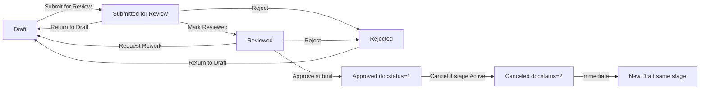
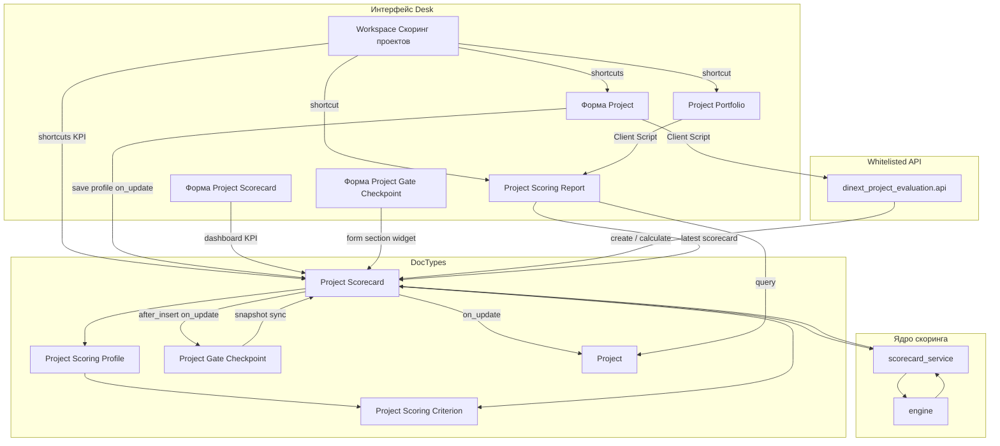

[English](README.md)

# Dinext Project Evaluation

## 📖 Обзор

**Dinext Project Evaluation** — приложение Frappe/ERPNext для формализованного скоринга проектов, scorecard-документов и аналитики портфеля поверх стандартных ERPNext Projects. PMO и менеджеры проектов могут задавать критерии и профили оценки, заполнять scorecard по стадиям проекта, рассчитывать взвешенный интегральный балл с правилами «ворот» и сравнивать проекты в Script Report с пузырьковой диаграммой.

Приложение интегрируется с существующим управлением проектами Dinext (Project Portfolio, Project Stage, stage-gate) и не заменяет модуль stage-gate. При установке и `migrate` автоматически импортируются fixture-backed типовые критерии и стартовый профиль оценки.

## ✨ Возможности

- **Каталог критериев скоринга** — числовые, валютные, процентные, логические и качественные (шкала) значения с направлением влияния и опциональными шкалами Likert.
- **Профили оценки** — веса, обязательность критериев, пороги gate по обязательным критериям (нормализованный балл и/или сырое число), применимость по стадиям; в UI показываются только релевантные пороговые поля.
- **Project Scorecard** — submittable DocType с workflow **Dinext Project Scorecard Approval** (отдельные роли согласования, не stage-gate), снимок профиля, расчёт интегрального балла и gate; проверка mandatory-критериев при уходе из Draft. **Dashboard KPI** на форме scorecard: компактные блоки **Integral Score**, **Gate Pass** и **Last Recalculated** в `frm.dashboard` после расчёта (секция «Evaluation Summary»); ручной пересчёт через пункт меню **Recalculate Score**. **Согласованной** считается только submitted-оценка (`docstatus = 1`); поле `status` остаётся бизнес-индикатором для UI. Подробнее — раздел [Workflow согласования](#workflow-согласования-project-scorecard) и [Dashboard KPI на форме Project Scorecard](#dashboard-kpi-на-форме-project-scorecard).
- **Автосоздание Draft scorecard** — при назначении профиля оценки проекту с активной стадией или при переходе **Project Stage Instance** в статус **Active** (если на проекте уже задан профиль); идемпотентно, без дубликатов на одну stage instance.
- **UI карточки Project** — form script (`project_scoring_evaluation.js`): выбор профиля оценки (только при заданной Governance Model), кнопки **Open Scorecards** / **Open Scoring Report** в меню Evaluation, переход к отчёту портфеля; сброс профиля при смене/очистке модели управления.
- **UI Project Portfolio** — переход к отчёту скоринга и пузырьковой диаграмме для выбранного портфеля.
- **Project Scoring Report** — фильтры по портфелю, проекту, типу проекта, статусу, модели управления, **Project Scoring Profile** (`custom_project_scoring_profile`), только активным проектам (`is_active = Yes`), текущей и оценённой стадии, gate pass и диапазону дат оценки; в выборку попадают submitted scorecard (`docstatus = 1`); таблица данных, bubble payload на сервере и пузырьковая диаграмма (ECharts) на клиенте; **клик по bubble** открывает связанную карточку **Project Scorecard**, а при её отсутствии — форму **Project**. Оси X/Y, размер и цвет bubble настраиваются **динамическими метриками** из runtime meta (**Project**, **Project Scorecard**, критерии профиля); списки метрик учитывают текущую выборку данных и скрытые поля DocType; см. [Project Scoring Report: динамические метрики](#project-scoring-report-динамические-метрики-и-bubble-chart).
- **Каталог по умолчанию из fixtures** — 10 групп критериев, 21 критерий и активный профиль **Базовый профиль оценки проектов** (`Default Project Scoring Profile`) с русскими display-именами, предметными шкалами 0–5, реалистичными диапазонами числовых показателей и stage-aware строками для стадий stage-gate (Идея, Инициирование, Реализация, Завершение). Системные ключи (`name`, `group_code`, `criterion_code`) остаются на английском для совместимости с `hooks.py` и отчётами.
- **Чистый scoring engine** — модуль расчёта без зависимости от Frappe ORM и unit-тесты нормализации, взвешивания и gate-логики.
- **Интеграция со Stage Gate** — флаг **Require Agreed Stage Scorecard** на `Stage Gate Template`; при включении checkpoint нельзя отправить в **In Review** без submitted scorecard (`docstatus = 1`) для той же `Project Stage Instance`. На форме `Project Gate Checkpoint` в секции **Stage Scorecard** (после `decision_comment`) — кликабельный KPI-виджет в стиле scorecard с переходом к связанной карточке; непройденные gate-пороги — **мягкое** предупреждение, не блокирует review. Подробнее — [Интеграция Stage Gate и scorecard](#интеграция-stage-gate-и-scorecard).
- **Workspace «Скоринг проектов»** — публичная рабочая область Desk с KPI number cards по статусам scorecard и покрытию профилем оценки, shortcuts к отчёту портфеля и операционным DocType, карточкой настройки каталога; доступ по ролям scorecard, `Dinext_Project_Manager` и `System Manager`. Подробнее — [Workspace «Скоринг проектов»](#workspace-скоринг-проектов).

## 🚀 Установка

Установка через [bench](https://github.com/frappe/bench):

```bash
cd $PATH_TO_YOUR_BENCH
bench get-app $URL_OF_THIS_REPO --branch develop
bench --site <site> install-app dinext_project_evaluation
bench --site <site> migrate
```

Источник истины для стартового scoring catalog — versioned fixtures в `dinext_project_evaluation/fixtures/`. После `install-app` и `migrate` на сайт подтягиваются workflow, роли, report, custom fields и каталог по умолчанию.

После изменений метаданных, workflow или fixture-backed master data экспортируйте fixtures в репозиторий (`dinext_project_evaluation/fixtures/`):

```bash
bench --site <site> export-fixtures
```

При `migrate` подтягиваются fixtures, в том числе workflow **Dinext Project Scorecard Approval**, роли scorecard-согласования и `Default Project Scoring Profile`. Одноразовые data-migration патчи в приложении не используются: актуальная схема и поведение обеспечиваются DocType JSON, fixtures и runtime hooks.

### Стартовый каталог скоринга (demo fixtures)

После `install-app` / `migrate` на сайт импортируется versioned demo-каталог из `dinext_project_evaluation/fixtures/`. Источник истины — записи на bench-сайте и `bench export-fixtures`, а не ручное редактирование JSON в репозитории.

**Граница локализации:**

| Слой | Язык | Примеры |
|------|------|---------|
| Системные ключи и ссылки | Английский | `Strategy`, `STR_ALIGN`, `Default Project Scoring Profile` |
| Display-поля demo-данных | Русский | `group_name`, `criterion_name`, `scale_label`, `key_phrases`, `profile_name`, `description` |
| UI DocType / workflow | Русский через `translations/ru.csv` | подписи полей, кнопки workflow |

**Группы критериев** (`project_scoring_criterion_group.json`) — 10 записей с русскими `group_name` и стабильными `name` / `group_code`: Стратегическое соответствие, Выгоды, Рынок и клиенты, Финансовая эффективность, Риски, Ресурсная обеспеченность, Нормативные ограничения, Приоритет и срочность, Инновационный потенциал, Среда и зависимости.

**Критерии** (`project_scoring_criterion.json`) — 21 критерий с русскими названиями, описаниями и предметными шкалами Likert 0–5 (вместо шаблонных «очень низко / низко / …»). Числовые критерии имеют реалистичные диапазоны, согласованные с `influence_direction`:

| Код | Тип | Диапазон / шкала |
|-----|-----|------------------|
| `STR_ALIGN`, `BEN_FIN`, `MKT_SHARE`, … | Scale 0–5 | Предметные формулировки по смыслу критерия |
| `COST`, `RD_COST`, `MFG_COST` | Currency | 0 … 200–500 млн руб. (`lower_is_better`) |
| `NPV`, `ECV` | Currency | −200 … +1000 млн / −50 … +500 млн руб. |
| `IRR`, `TECH_SUCCESS` | Percent | 0 … 60% / 0 … 100% |
| `PP` | Number (мес.) | 0 … 84 (`lower_is_better`) |
| `PI` | Number | 0 … 3 |
| `SALES_POT` | Boolean | Подтверждённый потенциал сбыта |

**Профиль по умолчанию** (`project_scoring_profile.json`) — одна запись `Default Project Scoring Profile`:

- **profile_name:** «Базовый профиль оценки проектов»
- **status:** Active
- **21 глобальная строка** — все критерии каталога с весами 1–3 и уровнем **Desired**
- **15 stage-specific строк** — усиление требований и порогов gate на стадиях stage-gate (имена стадий — как в `Project Stage` приложения `dinext_project_stage_gate`):

| Стадия | Примеры усиления |
|--------|------------------|
| **Идея** | `BEN_FIN`, `MKT_SHARE` — Mandatory, min normalized 0.4 |
| **Инициирование** | `STR_ALIGN` — Mandatory, min normalized 0.6; риски и ресурсы — Mandatory |
| **Реализация** | `TECH_SUCCESS` — Mandatory, raw 65…100%; `SALES_POT` — Mandatory (boolean gate) |
| **Завершение** | `REG` — min normalized 0.8; `NPV` — min raw 50 млн; `IRR` — 18…60%; `PP` — max 36 мес. |

Stage-specific строки **переопределяют** глобальные для той же пары «критерий + стадия» при расчёте scorecard (`resolve_stage_overridden_profile_rows`).

**Обновление demo-каталога на сайте:**

```bash
# 1. Изменить группы / критерии / профиль в Desk или через bench execute
# 2. Экспортировать fixtures обратно в репозиторий
bench --site <site> export-fixtures --app dinext_project_evaluation
```

Regression-тест целостности fixtures: `tests/test_scoring_demo_catalog.py`.

## Workflow согласования Project Scorecard

Жизненный цикл scorecard управляется **Frappe Workflow** с полем состояния **`status`** и стандартным **`docstatus`** submittable-документа. Статус на форме только для чтения; переходы — кнопками workflow на форме **Project Scorecard**.

**Workflow:** `Dinext Project Scorecard Approval`  
**Источник в репозитории:** `dinext_project_evaluation/fixtures/workflow.json`, `workflow_state.json`, `workflow_action_master.json`, `role.json`

### Submittable lifecycle и «согласованная» оценка

| Понятие | Источник истины | Примечание |
|---------|-----------------|------------|
| Бизнес-статус (Draft, Reviewed, Approved…) | поле `status` | UI, роли редактирования, расчёт integral/gate |
| Согласованная / финальная оценка | **`docstatus = 1`** | Отчёт портфеля, `custom_last_*` на Project, gate downstream |
| Отменённая оценка | `status = Canceled` и **`docstatus = 2`** | Не блокирует новую карточку для стадии |

Переход **Reviewed → Approved** через workflow вызывает `doc.submit()` (состояние Approved в workflow имеет `doc_status = 1`). Отмена submitted scorecard — через workflow **Cancel** (Approved → Canceled) или программный cancel для черновиков в промежуточных статусах.

### Роли (отдельно от stage-gate)

| Роль | Назначение |
|------|------------|
| **Project Scorecard Author** | Создаёт scorecard, заполняет критерии в Draft, отправляет на проверку |
| **Project Scorecard Reviewer** | Проверяет полноту, переводит в Reviewed или возвращает на доработку |
| **Project Scorecard Approver** | Утверждает оценку (Reviewed → Approved), **отменяет** scorecard (Cancel) |
| **Project Scorecard Admin** | Полный доступ к DocType; submit без права cancel |

Рекомендуемое соответствие существующим ролям Dinext (см. `scoring/workflow_constants.py`):

| Роль Dinext | Роль scorecard |
|-------------|----------------|
| `Dinext_Project_Manager` | Project Scorecard Author |
| `Project Governance Admin` | Project Scorecard Admin |

Пользователям нужно выдать соответствующие роли scorecard в **User** (помимо прав на Project / портфель). Stage-gate роли (`Stage Gate Owner`, `Reviewer`, `Approver`) в workflow scorecard **не** используются.

### Статусы, docstatus и расчёт

| Статус (`status`) | `docstatus` | Смысл | Расчёт integral / gate | В отчёте портфеля |
|-------------------|-------------|--------|------------------------|-------------------|
| Draft | 0 | Черновик, ввод значений | Нет | Нет |
| Submitted for Review | 0 | На проверке | Да (при save) | Нет |
| Reviewed | 0 | Проверка пройдена | Да (при save, пересчёт) | Нет |
| Approved | **1** | Утверждено (submitted) | Да (при save) | **Да** |
| Rejected | 0 | Возврат на доработку | Нет | Нет |
| Canceled | **2** | Процесс прекращён | Нет | Нет |

Ручное редактирование значений критериев и комментариев допускается только в **Draft**; во всех остальных статусах разрешены workflow-переходы и системный пересчёт, но не правка содержимого. Утверждённые и отменённые scorecard нельзя переводить обратно в более ранние статусы.

### Уникальность и replacement после Cancel

- На одну **`stage_instance_at_evaluation`** допускается **не более одного** scorecard со статусом, отличным от **Canceled** (включая Draft и Rejected — повторное создание не дублирует карточку, а переиспользует существующую).
- После **Cancel** для стадии **немедленно** создаётся новый **Draft** с тем же проектом, профилем и `stage_instance_at_evaluation` (если стадия ещё **Active** и карточки для неё нет).
- **Cancel** разрешён только пользователю с ролью **Project Scorecard Approver** и только пока связанная **Project Stage Instance** в статусе **Active**. Кнопка Cancel в UI скрывается workflow-условием на переходе Approved → Canceled; серверная проверка дублируется в `before_cancel()`.

### Переходы workflow

| Из | Действие | В | Кто | Примечание |
|----|----------|---|-----|------------|
| Draft | Submit for Review | Submitted for Review | Author | Расчёт integral / gate |
| Submitted for Review | Return to Draft | Draft | Reviewer | |
| Submitted for Review | Mark Reviewed | Reviewed | Reviewer | |
| Submitted for Review | Reject | Rejected | Reviewer | |
| Reviewed | Request Rework | Draft | Reviewer / Approver | |
| Reviewed | Approve | Approved | Approver | `doc.submit()` |
| Reviewed | Reject | Rejected | Approver | |
| Rejected | Return to Draft | Draft | Author | |
| Approved | Cancel | Canceled | Approver | Только если stage instance **Active**; `doc.cancel()` |

Отмена из **Draft / Submitted / Reviewed / Rejected** не оформлена workflow-переходом (ограничение Frappe: нельзя `docstatus 0 → 2` через workflow). Такие случаи обрабатывает `scoring/scorecard_cancel.py` (программный cancel + replacement draft).



### Разработка метаданных workflow

По политике Dinext: workflow, роли и состояния создаются в системе (MCP / Desk), затем выгружаются:

```bash
bench --site <site> migrate
bench --site <site> export-fixtures
```

Не правьте `fixtures/workflow*.json` и `role.json` вручную — только через экспорт после изменений на сайте. Исключение: условие на переход **Cancel** (Approved → Canceled) задаёт проверку активной stage instance и должно совпадать с логикой `scoring/scorecard_cancel.py`.

## Интеграция Stage Gate и scorecard

Расширения Stage Gate DocTypes поставляются из этого приложения через `fixtures/custom_field.json`, `doc_events` и `doctype_js`. Требуется установленное приложение **dinext_project_stage_gate** (`required_apps`).

### Настройка шаблона checkpoint

На **Stage Gate Template** доступен флаг **Require Agreed Stage Scorecard** (`require_agreed_stage_scorecard`). При создании **Project Gate Checkpoint** это значение копируется в одноимённое read-only поле checkpoint через `doc_events` этого приложения (`before_insert` / `after_insert`) и дальше используется как snapshot: последующие изменения шаблона не меняют уже созданные checkpoint. Stage Gate app не меняется.

Если snapshot-флаг на checkpoint включён, документ нельзя перевести в **In Review**, пока для той же **Project Stage Instance** нет submitted **Project Scorecard** (`docstatus = 1`).

**Согласованная** оценка определяется только `docstatus`, а не бизнес-статусом `status`. Бизнес-статус scorecard (`status`) показывается в dashboard-виджете checkpoint для контекста оператора.

### Поведение на форме Project Gate Checkpoint

При каждом сохранении checkpoint сервер синхронизирует скрытые read-only поля сводки scorecard (denormalized snapshot):

| Поле | Назначение |
|------|------------|
| `linked_stage_scorecard` | Ссылка на актуальную (последнюю не отменённую) карточку для stage instance |
| `scorecard_display_title` | Человекочитаемый заголовок (`scorecard_title`) |
| `scorecard_status` | Бизнес-статус scorecard |
| `scorecard_integral_score` | Интегральный балл |
| `scorecard_gate_pass` | Результат gate из scorecard |
| `scorecard_gate_warning` | Текст предупреждения из `gate_messages`, если gate не пройден |

Поля сводки **скрыты в layout формы** и не редактируются пользователем — они нужны для server sync, API fallback и тестов. Визуализация для оператора — HTML mount-point `stage_scorecard_widget_mount` в секции **Stage Scorecard**.

Пороги gate не дублируются на шаблоне stage-gate — используются только рассчитанные поля scorecard (`gate_pass`, `gate_messages`) из профиля оценки.

### Виджет Stage Scorecard на форме Project Gate Checkpoint

Form script [`public/js/project_gate_checkpoint_scorecard.js`](dinext_project_evaluation/public/js/project_gate_checkpoint_scorecard.js) рендерит кликабельный KPI-виджет в **исходной секции формы** **Stage Scorecard** (после `decision_comment`) через HTML mount-point `stage_scorecard_widget_mount`. Визуальный стиль совпадает с **Evaluation Summary** на форме **Project Scorecard**, но размещение — в layout формы, а не в `frm.dashboard`.

| KPI | Содержимое |
|-----|------------|
| **Integral Score** | `scorecard_integral_score` (формат `flt(..., 2)`; при отсутствии — «Not calculated») |
| **Gate Pass** | Passed / Failed с цветовым индикатором по `scorecard_gate_pass` |
| **Scorecard Status** | Бизнес-статус связанной scorecard (`scorecard_status`) |

В шапке виджета — заголовок связанной карточки (`scorecard_display_title` или `linked_stage_scorecard`), номер scorecard и подпись **Open scorecard**. При `gate_pass = 0` под карточками выводится список причин из `scorecard_gate_warning` (soft-warning: checkpoint может войти в review при наличии согласованной scorecard).

**Когда секция и виджет показываются:** секция видна при `require_agreed_stage_scorecard = 1`; виджет внутри секции — при наличии `linked_stage_scorecard` (после server sync или API fallback при открытии формы).

**Навигация:** клик по виджету (или Enter/Space при фокусе) открывает связанный **Project Scorecard** через `frappe.set_route`.

**Технические детали:**

- Стили: общий [`public/css/project_scorecard_dashboard.css`](dinext_project_evaluation/public/css/project_scorecard_dashboard.css) + классы `.dpe-checkpoint-scorecard-*`; lazy-load через `frappe.require`; CSS-переменные Desk для light/dark theme.
- Идемпотентный refresh: очистка mount `.dpe-checkpoint-scorecard-widget-mount`, render-token против дублирования при async-загрузке CSS.
- Переводы: контекст `Project Gate Checkpoint.StageScorecard` в [`translations/ru.csv`](dinext_project_evaluation/translations/ru.csv).

### Синхронизация при изменении scorecard

Сводка checkpoint обновляется при:

- сохранении checkpoint (validate);
- submit / cancel / изменении расчётных полей scorecard;
- `recalculate_in_place()` на scorecard (без смены workflow).

Сопоставление checkpoint ↔ scorecard выполняется по `stage_instance` = `stage_instance_at_evaluation`.

### API

`dinext_project_evaluation.api.get_checkpoint_scorecard_summary(checkpoint)` — нормализованная сводка для обновления формы; форма checkpoint вызывает этот API как fallback, если snapshot-поля ещё пустые.

Сводка scorecard на checkpoint синхронизируется при сохранении checkpoint, при `after_insert` scorecard и при изменениях расчётных полей scorecard.

## Workspace «Скоринг проектов»

Публичный Frappe Workspace модуля **Dinext Project Evaluation** — единая точка входа для PMO и менеджеров проектов. Метаданные versioned в репозитории и подтягиваются на сайт при `install-app` / `migrate` (стандартный импорт module JSON, не через `fixtures` в `hooks.py`).

**Путь в репозитории:** `dinext_project_evaluation/dinext_project_evaluation/workspace/скоринг_проектов/скоринг_проектов.json`  
**Number Card fixtures:** `dinext_project_evaluation/dinext_project_evaluation/number_card/`

В Desk: боковое меню → **Скоринг проектов** (иконка `activity`, модуль Dinext Project Evaluation).

### Доступ

Workspace виден пользователям с любой из ролей:

| Роль | Назначение |
|------|------------|
| **Project Scorecard Author** | Авторы scorecard |
| **Project Scorecard Reviewer** | Ревьюеры |
| **Project Scorecard Approver** | Утверждающие |
| **Project Scorecard Admin** | Администраторы scorecard |
| **Dinext_Project_Manager** | Менеджеры проектов Dinext |
| **System Manager** | Полный доступ Desk |

### Разделы и навигация

| Раздел на workspace | Содержимое |
|---------------------|------------|
| **Сводка оценки проектов** | Шесть KPI number cards (см. таблицу ниже) |
| **Аналитика портфеля** | Shortcut **Отчёт: оценка проектов** → **Project Scoring Report** |
| **Работа с карточками оценки** | Shortcuts: **Карточки оценки проектов**, **Проекты**, **Портфели проектов** |
| **Профили и критерии** | Card-ссылки: **Project Scoring Profile**, **Project Scoring Criterion**, **Project Scoring Criterion Group**, **Project Scorecard** |

### KPI number cards

На workspace отображаются пользовательские подписи; в репозитории каждая карточка — отдельный standard **Number Card** (`is_standard = 1`, `is_public = 1`, `function = Count`).

| Подпись на workspace | Имя Number Card | DocType | Фильтр |
|----------------------|-----------------|---------|--------|
| **Оценки в работе** | Карточки в работе | Project Scorecard | `status` in Draft, Rejected |
| **Оценки на согласовании** | Карточки на согласовании | Project Scorecard | `status` in Submitted for Review, Reviewed |
| **Согласованные оценки** | Согласованные карточки | Project Scorecard | `status` = Approved |
| **Оценки с непрохождением ворот** | Карточки с непрохождением gate | Project Scorecard | `status` = Approved и `gate_pass` = 0 |
| **Проекты с профилем оценки** | Проекты с профилем оценки | Project | `custom_project_scoring_profile` is set |
| **Проекты без профиля оценки** | Проекты без профиля оценки | Project | `custom_project_scoring_profile` is not set |

Карточки по scorecard используют бизнес-поле **`status`** (как в workflow), а не `docstatus` — для согласованных оценок фильтр **Approved** совпадает с submitted lifecycle (`docstatus = 1` после Approve).

### Разработка метаданных workspace

По политике Dinext: workspace и number cards создаются или правятся в Desk (или через MCP), затем экспортируются в module JSON:

```bash
bench --site <site> export-doc "Workspace" "Скоринг проектов"
bench --site <site> export-doc "Number Card" "Карточки в работе"
# … для остальных number cards
```

Либо скопируйте обновлённые JSON из `sites/<site>/…` в каталоги `workspace/` и `number_card/` модуля. Regression-тесты структуры: `tests/test_project_scoring_workspace.py`.

## 🛠️ Использование

### В интерфейсе Desk

1. Откройте workspace **Скоринг проектов** для сводки KPI и быстрых переходов, либо напрямую **Project Scoring Criterion** и **Project Scoring Profile** — просмотр или расширение каталога (либо используйте каталог по умолчанию из fixtures).
2. В **Project Scoring Profile** для каждой строки критерия задайте вес, обязательность и при необходимости пороги gate:
   - **Desired** — пороговые поля скрыты; gate не проверяется.
   - **Mandatory + шкала/да-нет** — доступен только **Minimum Normalized Score** (0…1).
   - **Mandatory + Number/Currency/Percent** — доступны normalized score и **Minimum/Maximum Raw Value**.
   - Неактуальные пороги автоматически очищаются при изменении строки и при сохранении профиля; при открытии формы выполняется только скрытие/показ полей.
3. На форме **Project** задайте **Governance Model** (из приложения stage-gate) — поле **Project Scoring Profile** (`custom_project_scoring_profile`) доступно только при заполненной модели управления. Фильтр link query учитывает портфель, компанию и тип проекта.
4. Заполните **Project Scoring Profile** и сохраните проект. При **первом** назначении профиля на проект с уже активной стадией автоматически создаётся **Draft** scorecard для текущей **Project Stage Instance** (см. [Автоматическое создание Project Scorecard](#автоматическое-создание-project-scorecard)). При смене профиля или модели управления активные scorecard отменяются (см. [Сброс профиля и scorecard на Project](#сброс-профиля-и-scorecard-на-project)).
5. Заполните строки scorecard в статусе **Draft** (или откройте автоматически созданный черновик через **Open Scorecards**). При переходе в любой другой статус (кроме **Canceled**) сервер и форма проверяют, что все **Mandatory**-критерии заполнены; незаполненные ячейки подсвечиваются в колонке **Value**.
6. Переведите scorecard по workflow: **Submit for Review** (расчёт интегрального балла и gate) → **Mark Reviewed** (пересчёт при необходимости) → **Approve** (submit, `docstatus = 1`). После **Submit for Review** на форме scorecard в dashboard появляется секция **Evaluation Summary** с KPI **Integral Score** и **Gate Pass** (см. [Dashboard KPI](#dashboard-kpi-на-форме-project-scorecard)). Утверждённые submitted scorecard обновляют денормализованные поля Project.
7. При необходимости **Cancel** (только **Approver**, только пока stage instance **Active**) — создаётся новый Draft для той же стадии.
8. Из **Project Portfolio** откройте **Project Scoring Report** для сравнения проектов и пузырьковой диаграммы.
9. В отчёте используйте фильтры: портфель, проект, тип проекта, статус, модель управления, **Project Scoring Profile**, «только активные проекты», текущая и оценённая стадия, gate pass, диапазон дат оценки; оси **X Axis**, **Y Axis**, **Bubble Size** и **Bubble Color** — отдельные выпадающие списки над диаграммой (метрики строятся из полей Project/Scorecard и критериев; в списках только поля с `hidden = 0` и только те метрики, для которых в текущей выборке есть хотя бы одно значение).
10. Смена метрики X/Y/size/color **автоматически обновляет** отчёт и диаграмму (как изменение обычного фильтра).
11. **Клик по bubble** проекта с agreed scorecard открывает форму соответствующего **Project Scorecard** (тот же маршрут, что у кликабельного виджета Stage Scorecard на checkpoint); если scorecard нет — открывается форма **Project**.

### Project Scoring Report: динамические метрики и bubble chart

Script Report [`project_scoring_report/`](dinext_project_evaluation/dinext_project_evaluation/report/project_scoring_report/) строит каталог метрик на сервере (`metric_registry.py`) и отдаёт его клиенту вместе с данными. Пользователь выбирает метрики в четырёх Select-контролах над диаграммой; технические фильтры `x_axis` / `y_axis` / `size_metric` / `color_metric` скрыты в стандартной панели фильтров и синхронизируются с видимыми контролами.

**Фильтры отчёта (стандартная панель):**

| Фильтр | Поле / источник | Примечание |
|--------|-----------------|------------|
| **Project Portfolio** | `Project.custom_project_portfolio` | |
| **Project** | `Project.name` | MultiSelectList |
| **Project Type** | `Project.project_type` | Link → Project Type |
| **Status** | `Project.status` | Open / Completed / Cancelled |
| **Governance Model** | `Project.governance_model` | Link → Project Governance Model (stage-gate) |
| **Project Scoring Profile** | `Project.custom_project_scoring_profile` | Назначенный на проекте профиль, не `Project Scorecard.profile` |
| **Only Active Projects** | `Project.is_active = Yes` | Check; при включении оставляет только активные проекты ERPNext |
| **Current Stage** | `Project.current_stage` | |
| **Evaluated Stage** | `Project Scorecard.stage_at_evaluation` | Требует agreed scorecard для строки |
| **Gate Pass** | `Project Scorecard.gate_pass` | Требует agreed scorecard для строки |
| **From Date** / **To Date** | `Project Scorecard.evaluation_date` | Требует agreed scorecard для строки |

Фильтры уровня **Project** сужают список проектов до сборки последнего agreed scorecard на проект. Фильтры уровня **Scorecard** дополнительно отсекают проекты без подходящей submitted-оценки (`docstatus = 1`).

| Группа метрик | Источник | Примеры |
|---------------|----------|---------|
| **Оси X/Y** | Поля **Project** и **Project Scorecard** (по meta + колонка в БД) | даты, числа, select/link |
| **Bubble Size** | Числовые поля Project/Scorecard + **сырые/нормализованные** значения критериев | `integral_score`, `Financial Value (Raw)` |
| **Bubble Color** | Категориальные поля Project/Scorecard + **шкальные** критерии | `status`, `Maturity` |

**Правила каталога и dropdown:**

- В выпадающих списках **нет скрытых полей** DocType (`hidden = 1` в meta не попадает в каталог).
- В списках **только метрики с данными** в текущей выборке (после применения фильтров отчёта); пустые метрики скрываются, выбор сбрасывается на допустимый default.
- Если одно и то же название поля есть у **Project** и **Project Scorecard**, в dropdown показываются различимые подписи: `Project - …` / `Project Evaluation - …` (только в списках; подписи осей/tooltip на графике остаются исходными label поля).
- Типы полей вроде Long Text, Table и layout-поля в каталог не включаются; **Check** доступен **только** для **Bubble Color** (не для осей X/Y и size); кастомные поля без колонки в БД отфильтровываются.

**Поведение bubble chart:**

| Ситуация | Поведение |
|----------|-----------|
| Пустое значение на **категориальной** оси X или Y | Точка попадает на ось в категорию **Не задано** (если в выборке есть хотя бы одна такая запись) |
| Пустое значение на **числовой** или **date/time** оси | Строка **не** рисуется на диаграмме |
| Пустое значение **Bubble Size** | Точка рисуется **минимальным** bubble (dot); в tooltip size показывается как N/A |
| Пустое **Bubble Color** | Цвет по fallback-токену «Unknown» (как раньше) |

Серверная сборка payload: [`project_scoring_report.py`](dinext_project_evaluation/dinext_project_evaluation/report/project_scoring_report/project_scoring_report.py) (`build_project_filters`, `build_bubble_chart_payload`, нормализация размеров, категория `Not Set` → перевод **Не задано**). Клиент: [`project_scoring_report.js`](dinext_project_evaluation/dinext_project_evaluation/report/project_scoring_report/project_scoring_report.js) (ECharts, disambiguation label в Select, auto-refresh при смене метрики).

### Навигация по bubble chart (Project Scoring Report)

На пузырьковой диаграмме каждая точка соответствует проекту. При клике клиентский обработчик (`handleBubbleChartClick` в [`project_scoring_report.js`](dinext_project_evaluation/dinext_project_evaluation/report/project_scoring_report/project_scoring_report.js)) выбирает маршрут по приоритету:

1. **Project Scorecard** — если у точки есть ссылка на последний agreed scorecard (`docstatus = 1`) для проекта.
2. **Project** — если scorecard отсутствует, но проект отображён на графике (например, оси X/Y используют project-метрики вроде `percent_complete`).

Если оба поля пусты, клик игнорируется. Курсор `pointer` на области графика задан в [`project_scoring_report.css`](dinext_project_evaluation/public/css/project_scoring_report.css).

### Сброс профиля и scorecard на Project

Профиль оценки привязан к **Governance Model**: поле `custom_project_scoring_profile` скрыто и недоступно, пока модель управления не задана (`depends_on: eval:doc.governance_model` в Custom Field).

При **смене или очистке Governance Model** приложение сбрасывает профиль оценки и отменяет все неотменённые **Project Scorecard** проекта. Подтверждение использует тот же флаг, что и stage-gate reset: `confirm_governance_reset` (отдельный scoring-диалог при смене governance не показывается).

| Сценарий | Подтверждение на форме | Сервер при save |
|----------|------------------------|-----------------|
| Смена/очистка **Governance Model** при наличии scorecard | `confirm_governance_reset = 1` (диалог stage-gate) | `cancel_project_scorecards()`, очистка `custom_project_scoring_profile` |
| Смена/очистка **Governance Model** без scorecard | не требуется | только очистка профиля |
| Прямая смена **Project Scoring Profile** при наличии scorecard | `confirm_scoring_profile_reset = 1` | `cancel_project_scorecards()` |

**Клиент** (`public/js/project_scoring_evaluation.js`):

- при смене governance model профиль очищается на форме без второго confirm;
- при отмене смены governance (stage-gate возвращает прежнее значение) профиль восстанавливается из временного stash до сохранения.

**Сервер** (`scoring/project_hooks.py`, hooks на **Project**):

- `validate` — блокирует save без подтверждения, если есть активные scorecard;
- `before_save` — отменяет scorecard и очищает профиль;
- `on_update` — при наличии профиля и Active stage instance создаёт новый Draft scorecard (`ensure_scorecard_for_stage_instance`).

> **Frappe 15:** серверный хук провижининга зарегистрирован на **`on_update`**, а не на `after_save`. Событие `after_save` в `doc_events` на сервере не вызывается при `doc.save()`; клиентский `after_save` в form script — отдельный механизм UI.

Custom Fields на **Project** (fixtures): `custom_project_scoring_profile`, `confirm_scoring_profile_reset` (hidden). Поле `governance_model` и `confirm_governance_reset` определены в приложении stage-gate.

### Автоматическое создание Project Scorecard

Draft scorecard создаётся сервером через `ensure_scorecard_for_stage_instance()` (`scoring/scorecard_factory.py`) — без ручного вызова API, если выполнены условия ниже.

| Триггер | Файл / событие | Когда срабатывает |
|---------|----------------|-------------------|
| Назначение или сохранение профиля на **Project** | `project_hooks.py` → `on_update` | На проекте задан `custom_project_scoring_profile`, текущая **Project Stage Instance** в статусе **Active** |
| Активация стадии | `scorecard_provision.py` → `on_update` на **Project Stage Instance** | Статус instance **перешёл** в **Active** (не повторно при save уже Active стадии) |
| Ручной / интеграционный вызов | `api.create_scorecard` | По запросу клиента или внешней системы |

**Условия провижининга:**

1. На **Project** задан **Project Scoring Profile** (`custom_project_scoring_profile`).
2. У проекта есть **current_stage_instance** (поле stage-gate); если в in-memory документе поле пустое, хук читает значение из сохранённой записи **Project** в БД.
3. Связанная **Project Stage Instance** имеет статус **Active**.
4. Для этой stage instance ещё нет неотменённого scorecard (идемпотентность).

**Порядок с stage-gate:** на `Project.on_update` сначала выполняется `dinext_project_stage_gate` (`sync_project_stage_chain`), затем провижининг evaluation — чтобы `current_stage_instance` успел обновиться при одновременной смене governance model и профиля.

**После деплоя** изменений hooks перезапустите bench (`bench restart`) или очистите кэш (`bench --site <site> clear-cache`), иначе воркеры могут держать старую регистрацию событий.

### Валидация обязательных критериев (Mandatory)

При переходе **Project Scorecard** из статуса **Draft** в любой другой (кроме **Canceled**):

- **Сервер** (`project_scorecard.py` + `scoring/criterion_config.py`): проверяются mandatory-критерии, обязательные комментарии и допустимость введённых значений по типу критерия (шкала, диапазон, boolean). Сообщение указывает коды критериев и причину отказа.
- **Клиент** (`project_scorecard.js`): подсветка незаполненных mandatory-строк и значений вне допустимого диапазона; правила синхронизированы с сервером.
- **Project Scoring Criterion**: серверная `validate()` проверяет согласованность конфигурации по `input_type` (`Scale` — только дискретная шкала через `scale_rows`; `Number`/`Currency`/`Percent` — диапазон `min_value`/`max_value`); форма скрывает неактуальные поля через metadata + form script.
- Переход **Draft → Canceled** не требует заполнения mandatory-критериев.
- Обязательность определяется полем **Requirement Level** в строках **Project Scoring Profile**, а не статическим `reqd` в DocType child table.

### Dashboard KPI на форме Project Scorecard

На форме **Project Scorecard** form script (`project_scorecard.js`) добавляет в **dashboard** (`frm.dashboard`) секцию **Evaluation Summary** с тремя компактными KPI-карточками:

| KPI | Содержимое |
|-----|------------|
| **Integral Score** | Интегральный балл (формат `flt(..., 2)`) |
| **Gate Pass** | Статус Passed / Failed с цветовым индикатором (green / red) |
| **Last Recalculated** | Дата и время последнего пересчёта (`evaluation_date`, формат пользователя Desk) |

При неуспешном gate под карточками выводится список причин из поля `gate_messages`.

**Когда виджет показывается:** после серверного расчёта — когда заполнены **`evaluation_date`** и **`integral_score`** (оба выставляются в `calculate()` при save в статусах **Submitted for Review**, **Reviewed** и **Approved**, а также после ручного пересчёта). Поле **`evaluation_date`** — метка **последнего** пересчёта, а не только первой оценки. На **Draft** dashboard KPI **скрыт**, пока не выполнен расчёт (в т.ч. ручной), даже если Float-поле `integral_score` на клиенте отображается как `0`.

**Rejected** с сохранённым `evaluation_date` и рассчитанным баллом показывает последний результат расчёта.

**Ручной пересчёт:** пункт меню формы **Recalculate Score** вызывает `dinext_project_evaluation.api.recalculate_scorecard` — пересчитывает integral/gate **на месте** **без смены статуса** workflow для карточек с **`docstatus = 0`**. При **`docstatus = 1`** (submitted) и **`docstatus = 2`** (cancelled) пункт меню скрыт, API возвращает ошибку.

**Технические детали:**

- Стили: [`public/css/project_scorecard_dashboard.css`](dinext_project_evaluation/public/css/project_scorecard_dashboard.css), lazy-load через `frappe.require`; CSS-переменные Desk для light/dark theme.
- Идемпотентный refresh: очистка секции `.dpe-scorecard-kpi-dashboard`, render-token против дублирования при async-загрузке CSS.
- Переводы: контекст `Project Scorecard.KPI` в [`translations/ru.csv`](dinext_project_evaluation/translations/ru.csv).

### Whitelisted API (Client Scripts и интеграции)

| Метод | Назначение |
|-------|------------|
| `dinext_project_evaluation.api.get_applicable_criteria` | Критерии для проекта и профиля с учётом стадии (`stage` опционален; по умолчанию — текущая стадия Project) |
| `dinext_project_evaluation.api.create_scorecard` | Создание черновика scorecard с применимыми строками |
| `dinext_project_evaluation.api.calculate_scorecard` | Workflow-переход к **Reviewed** (Submit for Review + Mark Reviewed) с пересчётом баллов |
| `dinext_project_evaluation.api.recalculate_scorecard` | Ручной пересчёт integral/gate **на месте** без смены статуса (только **`docstatus = 0`**) |
| `dinext_project_evaluation.api.approve_scorecard` | Workflow-утверждение scorecard и обновление денормализованных полей Project |
| `dinext_project_evaluation.api.get_checkpoint_scorecard_summary` | Сводка scorecard для checkpoint (snapshot + `checkpoint_fields` для client fallback) |

Пример проверки API и permissions:

```bash
bench --site <site> run-tests --module dinext_project_evaluation.tests.test_api
```

### Проверка

```bash
cd apps/dinext_project_evaluation
node --test \
  tests/test_project_scoring_report.test.js \
  tests/test_project_scoring_evaluation.test.js \
  tests/test_project_scoring_profile.test.js \
  tests/test_project_gate_checkpoint_scorecard.test.js \
  tests/test_project_portfolio_scoring_navigation.test.js

python3 -m unittest tests.test_project_scoring_workspace tests.test_scoring_demo_catalog

bench --site <site> run-tests \
  --module dinext_project_evaluation.tests.test_api \
  --module dinext_project_evaluation.tests.test_gate_fields \
  --module dinext_project_evaluation.tests.test_scoring_engine \
  --module dinext_project_evaluation.tests.test_scorecard_service \
  --module dinext_project_evaluation.tests.test_scorecard_cancel \
  --module dinext_project_evaluation.tests.test_scorecard_factory \
  --module dinext_project_evaluation.tests.test_workflow_constants \
  --module dinext_project_evaluation.tests.test_criterion_config \
  --module dinext_project_evaluation.tests.test_profile_criterion_stage_validation \
  --module dinext_project_evaluation.tests.test_stage_gate_scorecard_integration \
  --module dinext_project_evaluation.dinext_project_evaluation.doctype.project_scorecard.test_project_scorecard
```

GitHub Actions в репозитории гоняет Semgrep и JS regression tests; Frappe `bench run-tests` остаётся обязательной локальной проверкой на bench-сайте. Сценарии приёмки описаны в [docs/2026-04-28-project-scoring-architecture-and-task.md](docs/2026-04-28-project-scoring-architecture-and-task.md).

## 📦 Технологии

- **Python 3.10+** — scoring engine, контроллеры DocType, backend Script Report, whitelisted API
- **Frappe Framework / ERPNext** — DocTypes, fixtures, Client Scripts, Query Report
- **JavaScript** — Client Scripts (Project, Project Portfolio), form scripts Project Scorecard (grid + dashboard KPI) и Project Gate Checkpoint (кликабельный виджет Stage Scorecard в секции формы), Script Report Project Scoring Report (динамические Select метрик, ECharts bubble chart, auto-refresh); клик по bubble → **Project Scorecard**, при отсутствии scorecard → **Project**
- **Ruff, ESLint, Prettier** — линтинг и форматирование через pre-commit

## 🔧 Конфигурация

| Расположение | Назначение |
|--------------|------------|
| `dinext_project_evaluation/hooks.py` | `required_apps`, `fixtures`, `doc_events` на Project / Project Stage Instance |
| `dinext_project_evaluation/public/js/project_scoring_evaluation.js` | Форма Project: профиль оценки, сброс при смене governance model, кнопки Evaluation |
| `dinext_project_evaluation/public/css/project_scorecard_dashboard.css` | KPI-карточки: dashboard **Project Scorecard** (Evaluation Summary) и in-form виджет **Project Gate Checkpoint** (Stage Scorecard) |
| `dinext_project_evaluation/public/js/project_gate_checkpoint_scorecard.js` | Форма Project Gate Checkpoint: API fallback, кликабельный виджет Stage Scorecard в секции формы |
| `dinext_project_evaluation/dinext_project_evaluation/report/project_scoring_report/metric_registry.py` | Runtime-каталог метрик X/Y/size/color из meta Project, Scorecard и критериев; фильтр hidden-полей и колонок БД |
| `dinext_project_evaluation/dinext_project_evaluation/report/project_scoring_report/project_scoring_report.py` | Backend Script Report: фильтры Project/Scorecard, данные, bubble payload, категория «Не задано», нормализация размеров bubble |
| `dinext_project_evaluation/dinext_project_evaluation/report/project_scoring_report/project_scoring_report.js` | Отчёт Project Scoring Report: Select метрик, ECharts bubble chart, disambiguation подписей, auto-refresh, навигация bubble → **Project Scorecard** или **Project** |
| `dinext_project_evaluation/public/css/project_scoring_report.css` | Стили bubble chart отчёта (legend, empty state, курсор кликабельности) |
| `dinext_project_evaluation/scoring/stage_gate_integration.py` | Синхронизация snapshot-полей scorecard на checkpoint, hard-gate validate, backfill |
| `dinext_project_evaluation/scoring/stage_gate_checkpoint_hooks.py` | `doc_events` на Project Gate Checkpoint и Project Scorecard для sync summary |
| `dinext_project_evaluation/scoring/project_hooks.py` | Validate / before_save / on_update: сброс профиля, отмена scorecard, автосоздание Draft scorecard |
| `dinext_project_evaluation/scoring/scorecard_provision.py` | `on_update` на Project Stage Instance: Draft scorecard при переходе стадии в Active |
| `dinext_project_evaluation/fixtures/` | Экспорт Client Scripts, Custom Fields, workflow, report и fixture-backed demo-каталога: `project_scoring_criterion_group.json`, `project_scoring_criterion.json`, `project_scoring_profile.json` |
| `dinext_project_evaluation/scoring/criterion_config.py` | Валидация конфигурации критериев и введённых значений scorecard |
| `dinext_project_evaluation/dinext_project_evaluation/doctype/project_scoring_criterion/project_scoring_criterion.js` | Условная видимость полей критерия по `input_type` |
| `dinext_project_evaluation/scoring/workflow_constants.py` | Статусы, роли, действия workflow; `SCORECARD_AGREED_DOCSTATUS`, `SCORECARD_CANCEL_ROLES` |
| `dinext_project_evaluation/scoring/workflow.py` | Whitelisted workflow-переходы (calculate / approve / cancel) |
| `dinext_project_evaluation/scoring/scorecard_cancel.py` | Проверки Cancel (роль Approver, Active stage), replacement draft, bulk cancel |
| `dinext_project_evaluation/dinext_project_evaluation/doctype/project_scoring_profile/project_scoring_profile.js` | Условная видимость порогов gate в форме профиля |
| `dinext_project_evaluation/dinext_project_evaluation/doctype/project_scorecard/project_scorecard.js` | Grid ввода значений критериев, валидация mandatory при уходе из Draft, подсветка ячеек, **dashboard KPI**, ручной пересчёт |
| `dinext_project_evaluation/translations/ru.csv` | Русские переводы |
| `dinext_project_evaluation/dinext_project_evaluation/workspace/скоринг_проектов/` | Workspace **Скоринг проектов**: layout, shortcuts, roles |
| `dinext_project_evaluation/dinext_project_evaluation/number_card/` | Standard Number Card KPI для workspace (фильтры по status scorecard и профилю на Project) |

Fixtures из `hooks.py` экспортируют:

- `project_scoring_criterion_group.json`, `project_scoring_criterion.json`, `project_scoring_profile.json`;
- `client_script.json`, `report.json`, `custom_field.json`;
- `role.json` — Project Scorecard Author / Reviewer / Approver / Admin;
- `workflow.json`, `workflow_state.json`, `workflow_action_master.json` — **Dinext Project Scorecard Approval**.

Отдельные переменные окружения не требуются — достаточно стандартного bench-сайта с ERPNext.

### Типы ввода критериев

| `input_type` | Конфигурация | Ввод в scorecard |
|--------------|--------------|------------------|
| **Scale** | Дискретная шкала: таблица `scale_rows` (обязательна) | Select по вариантам шкалы |
| **Number** / **Currency** / **Percent** | Диапазон `min_value`..`max_value` (обязателен) | Числовое поле соответствующего типа |
| **Boolean** | `boolean_true_score` / `boolean_false_score` | Check |

## ✅ Требования

- Administrator с установленным **ERPNext** (`required_apps = ["erpnext"]`)
- Python **>= 3.10**
- Расширения Dinext на сайте: **Project Portfolio**, **Project Stage**, **Governance Model** / stage-gate на Project (поля stage instance, `governance_model`, `confirm_governance_reset`)
- Для разработки: [pre-commit](https://pre-commit.com/#installation)

## 🤝 Участие в разработке

В репозитории настроен pre-commit:

```bash
cd apps/dinext_project_evaluation
pre-commit install
```

Инструменты: ruff, eslint, prettier, pyupgrade.

Конвенции агентов и shared-политики Dinext: [AGENTS.md](AGENTS.md).

## 📄 Документация

| Документ | Описание |
|----------|----------|
| [docs/2026-04-28-project-scoring-architecture-and-task.md](docs/2026-04-28-project-scoring-architecture-and-task.md) | Архитектура, модель данных, правила расчёта, UX, приёмка |
| [sources/pdfs/md/](sources/pdfs/md/) | Справочные материалы (скоринговые модели, управление портфелем) |
| [AGENTS.md](AGENTS.md) | Навигация агента Dinext и порядок загрузки central docs |

## 📝 Changelog

| Commit | Кратко |
|--------|--------|
| *(текущая ветка)* | **Demo-каталог скоринга:** русские display-имена групп и критериев, предметные шкалы и реалистичные диапазоны; заполнен `Default Project Scoring Profile` (36 строк, stage-aware пороги); regression `tests/test_scoring_demo_catalog.py` |
| *(предыдущая)* | **Workspace «Скоринг проектов»:** KPI number cards, shortcuts к отчёту и DocType, card настройки каталога; role-based доступ; regression `tests/test_project_scoring_workspace.py` |
| *(предыдущая)* | **Project Scoring Report:** фильтры тип проекта, статус, Governance Model, Project Scoring Profile (`custom_project_scoring_profile`), только активные проекты; project-фильтры через `build_project_filters`, profile больше не фильтрует scorecard |
| *(предыдущая)* | **Project Scoring Report:** динамические метрики X/Y/size/color из runtime meta; dataset-aware dropdown; auto-refresh при смене метрики; категория **Не задано** на категориальных осях; минимальный bubble при пустом size; disambiguation `Project - …` / `Project Evaluation - …` в Select; исключение hidden DocFields из каталога |
| *(предыдущая)* | Виджет **Stage Scorecard** в исходной секции формы Project Gate Checkpoint (`stage_scorecard_widget_mount`); скрытые snapshot-поля; reuse CSS `project_scorecard_dashboard.css`; API fallback `get_checkpoint_scorecard_summary` |
| *(предыдущая)* | Dashboard KPI на форме Project Scorecard: Integral Score и Gate Pass в `frm.dashboard`; видимость после расчёта (`evaluation_date` + `integral_score`); CSS `project_scorecard_dashboard.css` |
| *(предыдущая)* | Автосоздание Draft scorecard при назначении профиля: серверный хук на `Project.on_update` (не `after_save`); резолв `current_stage_instance` из документа или БД |
| *(предыдущая)* | Сброс `custom_project_scoring_profile` и отмена scorecard при смене/очистке Governance Model; единый confirm через `confirm_governance_reset` |
| *(предыдущая)* | Submittable Project Scorecard (`docstatus` lifecycle); Cancel только Approver + Active stage; replacement draft после Cancel; отчёт по `docstatus = 1` |
| `089e159` | Выравнивание с Dinext: зависимость erpnext, AGENTS.md |
| `c448318` | Инициализация каркаса приложения |

## 🗂️ Структура репозитория

```
dinext_project_evaluation/
├── AGENTS.md                          # Инструкции для агентов
├── README.md
├── pyproject.toml                     # метаданные пакета, конфиг ruff
├── docs/
│   └── 2026-04-28-project-scoring-architecture-and-task.md
├── sources/pdfs/md/                   # справочные PDF (markdown)
└── dinext_project_evaluation/
    ├── hooks.py                       # fixtures, required_apps
    ├── api.py                         # whitelisted API scorecard
    ├── scoring/
    │   ├── engine.py                  # чистые расчёты (unit-тесты)
    │   ├── gate_fields.py             # релевантность и sanitize порогов gate
    │   ├── scorecard_service.py       # адаптер Frappe document ↔ engine
    │   ├── scorecard_factory.py       # создание/sync строк scorecard из профиля
    │   ├── project_hooks.py           # Project hooks: сброс профиля, cancel, on_update provision
    │   ├── scorecard_cancel.py        # cancel, replacement draft, bulk cancel
    │   ├── scorecard_provision.py     # автосоздание Draft по stage instance
    │   ├── workflow_constants.py      # статусы, роли, docstatus/cancel constants
    │   ├── workflow.py                # workflow-переходы calculate / approve / cancel
    │   ├── stage_gate_integration.py  # checkpoint ↔ scorecard sync, hard-gate validate
    │   └── stage_gate_checkpoint_hooks.py  # doc_events checkpoint и scorecard
    ├── tests/
    │   ├── test_project_scoring_report.py      # unit-тесты metric registry и bubble payload
    │   ├── test_project_scoring_report.test.js # unit-тесты client report (Select метрик, refresh)
    │   ├── test_gate_fields.py
    │   ├── test_scoring_engine.py
    │   ├── test_scorecard_service.py
    │   ├── test_scorecard_factory.py
    │   ├── test_scorecard_cancel.py
    │   ├── test_stage_gate_scorecard_integration.py
    │   └── test_scoring_demo_catalog.py       # regression: русский demo-каталог и default profile fixtures
    ├── fixtures/                      # вывод bench export-fixtures (+ workflow + default catalog)
    ├── public/
    │   ├── js/project_scoring_evaluation.js  # форма Project: профиль, governance reset, кнопки Evaluation
    │   ├── js/project_gate_checkpoint_scorecard.js  # форма checkpoint: виджет Stage Scorecard в секции формы
    │   ├── css/project_scorecard_dashboard.css  # KPI dashboard на формах Project Scorecard и Project Gate Checkpoint
    │   └── css/project_scoring_report.css     # bubble chart в Project Scoring Report
    ├── translations/ru.csv
    └── dinext_project_evaluation/
        ├── doctype/                   # DocTypes скоринга + Project Scorecard
        ├── workspace/скоринг_проектов/ # Workspace «Скоринг проектов»
        ├── number_card/               # KPI cards для workspace
        └── report/
            └── project_scoring_report/  # Script Report: metric_registry + bubble payload + ECharts UI
```

| Путь | Назначение |
|------|------------|
| `scoring/engine.py` | Нормализация вводов, веса, правила gate |
| `scoring/gate_fields.py` | Какие пороги gate допустимы для строки профиля; очистка неактуальных значений |
| `scoring/scorecard_service.py` | Преобразование строк Scorecard в входные данные engine; `missing_mandatory_criterion_codes()` |
| `scoring/scorecard_factory.py` | Создание/sync строк scorecard; поиск agreed/non-canceled scorecard для стадии; `cancel_project_scorecards()` |
| `scoring/project_hooks.py` | Validate/before_save/on_update на Project: сброс профиля, автосоздание Draft при профиле + Active stage |
| `scoring/scorecard_provision.py` | on_update на Project Stage Instance: Draft при переходе стадии в Active |
| `scoring/scorecard_cancel.py` | Валидация Cancel, replacement draft, `cancel_project_scorecards()` |
| `scoring/workflow.py` | Workflow-переходы scorecard (Submit for Review, Mark Reviewed, Approve, Cancel) |
| `doctype/project_scorecard/` | Submittable lifecycle, `before_cancel` / `on_cancel`, расчёт при save, mandatory |
| `doctype/project_scorecard/project_scorecard.js` | Grid ввода значений, client-side валидация, подсветка mandatory-ячеек, dashboard KPI |
| `public/js/project_gate_checkpoint_scorecard.js` | Виджет Stage Scorecard в секции формы checkpoint, переход к связанной scorecard |
| `scoring/stage_gate_integration.py` | Snapshot summary на checkpoint, validate In Review, backfill |
| `scoring/stage_gate_checkpoint_hooks.py` | Hooks checkpoint/scorecard для sync summary |
| `doctype/project_scoring_*` | Критерии, шкалы, профили, строки профиля с опциональной стадией и порогами gate |
| `doctype/project_scoring_profile/project_scoring_profile.js` | Условное отображение порогов gate по обязательности и типу критерия |
| `report/project_scoring_report/metric_registry.py` | Каталог метрик, defaults, dataset-aware filter, исключение hidden DocFields |
| `report/project_scoring_report/project_scoring_report.py` | Execute отчёта, bubble payload, ось «Не задано», MIN bubble size |
| `report/project_scoring_report/project_scoring_report.js` | UI метрик, ECharts, клик bubble → форма **Project Scorecard** или **Project** |
| `tests/test_project_scoring_report.py` | Regression: catalog, bubble payload, Not Set, size normalization |
| `tests/test_project_scoring_report.test.js` | Regression: metric controls, label disambiguation, refresh |
| `fixtures/` | Версионируемые метаданные и русифицированный demo-каталог (группы, 21 критерий, default profile) для migrate/install |
| `tests/test_scoring_demo_catalog.py` | Regression: русские `group_name`, шкалы, диапазоны, stage-aware default profile |
| `workspace/скоринг_проектов/` | Публичный Desk workspace: KPI, shortcuts, card профилей и критериев |
| `number_card/` | Count-фильтры по status scorecard и `custom_project_scoring_profile` на Project |
| `tests/test_project_scoring_workspace.py` | Regression: структура workspace, соответствие number cards, фильтры |

## 🔗 Схема потоков



**Поток данных (scorecard):** создаётся **Draft** (вручную, API, `Project.on_update` при назначении профиля, или `Project Stage Instance.on_update` при активации стадии) → заполнение критериев → workflow **Submit for Review** (расчёт) → **Mark Reviewed** (пересчёт) → **Approve** (submit, `docstatus = 1`) → обновление `custom_last_*` на **Project**. **Cancel** (Approver, Active stage) → replacement **Draft** для той же стадии. **Project Scoring Report** берёт последний scorecard с **`docstatus = 1`** для выбранной стадии; bubble на диаграмме по клику открывает форму scorecard или, если его нет, форму **Project**.

**Поток checkpoint ↔ scorecard:** при save checkpoint / create-update scorecard сервер синхронизирует snapshot-поля на **Project Gate Checkpoint** по ключу `stage_instance` = `stage_instance_at_evaluation`; форма checkpoint при пустом snapshot подгружает сводку через API и рендерит кликабельный виджет **Stage Scorecard** в секции формы после `decision_comment`.

**Поток автопровижининга на Project:** сохранение **Project** с заданным профилем → `on_update` (после stage-gate) → `ensure_scorecard_for_stage_instance` → **Draft** scorecard с критериями текущей стадии, если stage instance **Active** и карточки для неё ещё нет.

**Поток сброса на Project:** смена **Governance Model** или **Project Scoring Profile** → подтверждение на форме → `before_save` отменяет неотменённые scorecard и при смене governance очищает профиль → `on_update` при Active stage и заданном профиле создаёт новый Draft.

**Поток валидации:** при любом уходе из **Draft**, кроме **Canceled**, сервер и форма требуют заполнения mandatory-критериев (см. раздел «Валидация обязательных критериев»).

## Лицензия

GNU GPL v3. Текст — в [license.txt](license.txt).
